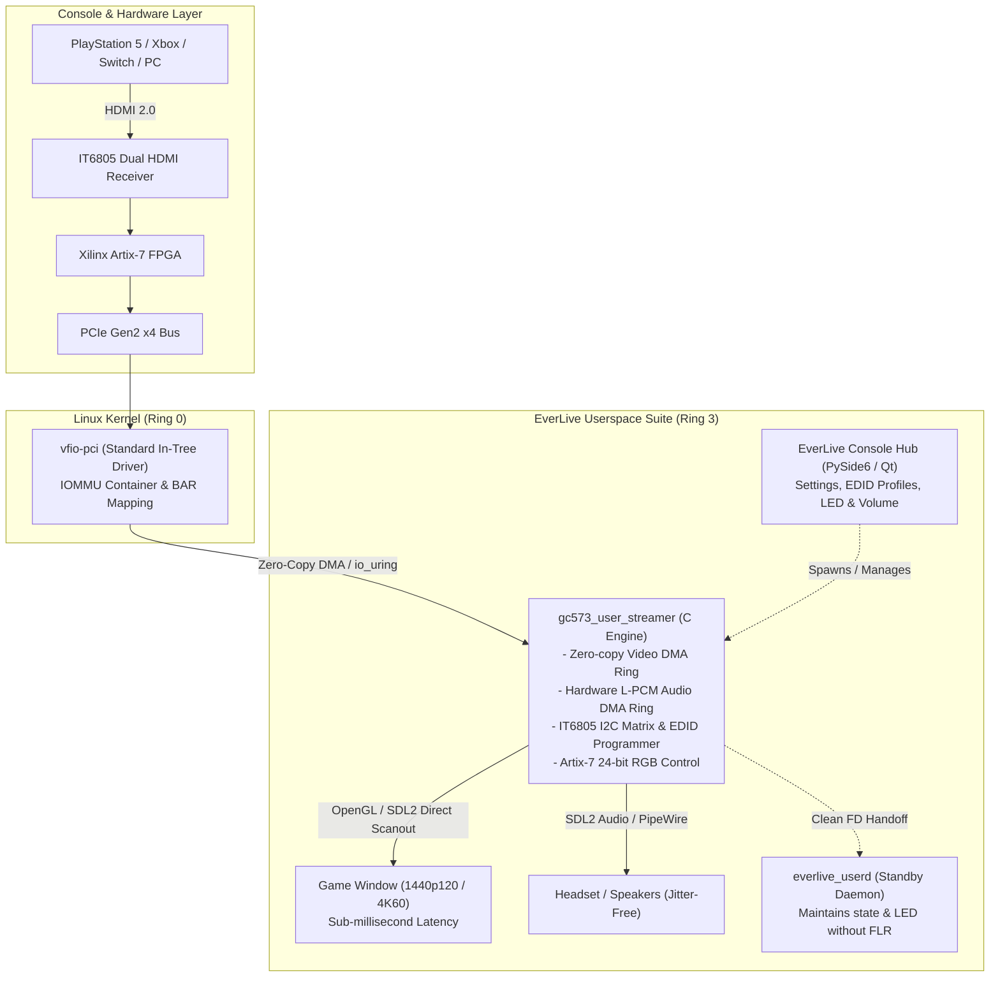

# EverLive - AVerMedia GC573 Linux Gaming Suite & Userspace Driver

[](https://github.com/Everlite/EverLive/releases)
[-brightgreen.svg)](#highlights--verified-capabilities)
[](#-the-userspace-era-v100-architecture)
[](#why-userspace-vfio)
[-Safe%20%26%20Clean-success.svg)](#why-userspace-vfio)
[](https://github.com/sponsors/Everlite)
[](https://discord.com/invite/D2XFhkPMmc)
[](#legal-and-licensing)
[](#-transparency--ai-assistance)

**EverLive v1.0.0** is an all-in-one Linux console gaming suite and 100% blob-free, open-source userspace driver for the **AVerMedia Live Gamer 4K (GC573)** (PCI `1461:0054`, Subsystem `1461:5730`).

With **EverLive**, you can play PlayStation 5, Xbox Series X, Nintendo Switch, retro scalers (RetroTINK 4K), or PCs directly on your Linux desktop (Wayland & X11) at **1440p @ 120 FPS** or **native 4K @ 60 FPS** with ultra-low latency, synchronized uncompressed L-PCM audio, on-the-fly hardware EDID management, and dynamic RGB LED lighting.

---

## ⚡ The Userspace Era (v1.0.0 Architecture)

EverLive v1.0.0 marks a quantum leap: **the complete departure from out-of-tree kernel modules**.  
The capture engine runs **100% in Ring 3 userspace** via Linux's native `vfio-pci` interface.

### Why Userspace VFIO?
* 🛡️ **Immune to Kernel Updates:** Never break on system updates again. No DKMS compilation, no broken builds when Linux 6.13, 6.14, or 7.x updates arrive.
* 🔒 **100% Secure Boot Compatible:** Runs out-of-the-box on Ubuntu, Fedora, Debian, and openSUSE with UEFI Secure Boot enabled. No custom Machine Owner Keys (MOK) or kernel signing needed.
* 🎮 **Anti-Cheat Safe (EAC / BattlEye):** Does not touch or taint the Linux kernel. No out-of-tree `.ko` modules that could trigger competitive gaming anti-cheat flags.
* 🚀 **Unmatched Performance:** Zero-copy PCIe Scatter-Gather DMA directly into user-mapped buffers with sub-millisecond dispatch to SDL2 OpenGL rendering.
* 🔊 **Direct PCIe DMA Audio:** High-fidelity L-PCM audio stream captured directly via hardware DMA and fed straight into SDL2/PipeWire — crystal clear, zero crackling, zero drift.
* 🔄 **On-the-Fly Hardware EDID Switching:** Instantly inject custom or forced EDID profiles (1440p120, 1080p240, 4K60 HDR) straight into the IT6805 HDMI receiver chip without disconnecting cables.

> *Note: The legacy kernel driver has been moved to [`legacy/open_gc573-kernel/`](legacy/open_gc573-kernel/) and is preserved for historical and educational reference.*

---

## 🚀 Quickstart: 1-Click Installation (Beginner-Friendly)

Installation takes less than 30 seconds. No kernel headers or compiler toolchains for the kernel are required.

```bash
git clone https://github.com/Everlite/EverLive.git
cd EverLive
sudo ./install.sh
```

### What the installer does:
1. **Installs runtime packages:** Installs standard user-level libraries (`libsdl2-dev`, `python3-pyside6`, `build-essential`, `pciutils`).
2. **Configures VFIO & udev permissions:** Grants your local user non-root access to the capture card's VFIO container and sets up `vfio-pci` binding.
3. **Optimizes Memory Locking:** Configures PAM memlock (`/etc/security/limits.d/99-everlive-memlock.conf`) and assigns `cap_ipc_lock` so native 4K DMA buffers can be pinned effortlessly.
4. **Builds the Userspace Engine:** Compiles `gc573_user_streamer` and `everlive_userd` in `tools/opengc573-userd/`.
5. **Adds a Desktop Launcher:** Adds the **EverLive** application to your system application menu.

After installation, launch **EverLive** from your application menu, or run:
```bash
./play.sh
```

---

## Highlights & Verified Capabilities

- **2560×1440 @ 120 FPS & Native 3840×2160 @ 60 FPS (Hardware Verified on PS5):**  
  Tested and verified on PlayStation 5 (*The Finals*, *Fortnite 120Hz Mode*, PS5 Dashboard) and PC. Direct presentation delivers rock-solid frame pacing, ultra-low input lag, and full 120 Hz motion clarity.
- **Hardware EDID Profile Management:**  
  Change how your console perceives the capture card on the fly:
  - `Default (4K60 / 1440p120 HDR)`: Standard multi-mode EDID profile.
  - `Force 1440p @ 120 Hz`: Enforces high-refresh 120Hz negotiation for consoles.
  - `Force 1080p @ 240 Hz`: Optimizes for ultra-high competitive refresh rates.
  - `Load Custom EDID (.bin)`: Flash any 256-byte EDID binary directly into the IT6805 receiver RAM!
- **Uncompressed High-Fidelity Audio DMA:**  
  Captures native 16-bit / 48kHz L-PCM console audio directly over PCIe DMA into an adaptive SDL2 ring buffer. Seamlessly routes to your headset or speakers via PipeWire, completely crackle-free and synchronized with gameplay.
- **Live Dynamic Hot-Switching:**  
  Seamlessly transitions between resolutions and refresh rates (e.g. 720p $\leftrightarrow$ 1080p $\leftrightarrow$ 1440p 60/120 $\leftrightarrow$ 4K60) on the fly without black screens or crashes.
- **Hardware RGB LED Lighting Control:**  
  Native 24-bit True RGB control via Artix-7 FPGA registers. Choose between 8 colors (or turn it completely dark) from the GUI or CLI (`./play.sh --led magenta`).
- **Seamless Standby Daemon (`everlive_userd`):**  
  When closing the gaming screen, EverLive hands off the hardware state to a lightweight background daemon without resetting the card (FLR), maintaining your preferred LED lighting and keeping the HDMI handshake warm for instant re-opening.
- **Retro Scalers & Custom Modelines (RetroTINK 4K Pro):**  
  Extensively verified by contributor [@haxman](https://github.com/haxman): supports 240p retro modes (`1440x240`, `1920x240` CRT Super-Resolution), 480i / 576i interlaced modes with automatic 4:3 letterboxing, PAL 50Hz/100Hz, and Cinema 95.94Hz BFI modes.

---

## 🎮 EverLive Console Hub & Game Window


**Console Hub Features (`everlive_viewer.py`):**
- **Live Signal Monitor:** Real-time resolution, refresh rate, and signal status badge.
- **EDID Preset Selector:** Switch between Default, Force 1440p120, Force 1080p240, or load custom `.bin` files.
- **Hardware RGB LED Selector:** Real-time color switcher for the card's LED bar.
- **Direct PipeWire Volume Slider:** Live volume and mute control directly hooked into the audio engine.
- **Instant Launch:** Toggle fullscreen, VSync, or clean Streamer Mode.

**Command-line shortcuts:**
```bash
./play.sh                        # Open the EverLive Console Hub
./play.sh --cli -f               # Launch directly into full-screen gaming mode (no GUI)
./play.sh --led cyan             # Set the RGB LED color directly
./play.sh --cli --edid 1440p120  # Launch with 1440p120 forced EDID
```

---

## Architecture



---

## Repository Structure

| Directory / File | Description |
|:---|:---|
| **`play.sh`** | Main entrypoint; handles VFIO binding and launches the suite. |
| **`install.sh`** | One-click installer (runtime dependencies, VFIO udev rules, memlock limits, desktop launcher). |
| **`uninstall.sh`** | Clean uninstaller that removes udev rules, limits, and desktop launchers. |
| **`tools/opengc573-userd/`** | **The Userspace Engine:** `gc573_user_streamer` (DMA, video/audio capture, EDID, LED) and `everlive_userd` (standby daemon). |
| **`tools/everlive/`** | **Console Hub & GUI:** `everlive_viewer.py` (Qt interface, EDID switcher, volume integration). |
| **`legacy/open_gc573-kernel/`** | **Legacy Kernel Driver:** Original out-of-tree kernel module (retained for historical/educational reference). |

---

## Controls & Hotkeys During Gameplay

| Key / Action | Function |
|:---|:---|
| **Mouse Wheel Up / Down** | Volume up / down in 5% steps (with on-screen feedback) |
| <kbd>m</kbd> | Mute / unmute audio |
| <kbd>F11</kbd> or <kbd>f</kbd> (or double-click) | Toggle borderless fullscreen |
| <kbd>s</kbd> or <kbd>F10</kbd> | Toggle **Streamer Mode (Clean Feed)** — hides cursor & suppresses HUD for OBS capture |
| <kbd>Tab</kbd> or <kbd>i</kbd> | Show / hide stats overlay (FPS, frame delivery, jitter) |
| <kbd>Esc</kbd> or <kbd>q</kbd> | Close the game window |

---

## 💖 Support the Project & Hardware Fund

**EverLive** is an independent, non-commercial open-source project created and maintained by **[Everlite](https://github.com/Everlite)** in his spare time. There is no corporation or venture capital behind this — just deep passion for low-level Linux graphics, FPGA register reverse-engineering, and seamless console gaming on Linux.

### Why is there a GitHub Sponsors link?
Writing clean-room, open-source Linux drivers for proprietary capture cards requires having the **physical hardware on the test bench**. PCIe capture cards cannot be emulated; reverse-engineering HDMI bridge chips, I2C matrices, and DMA ring descriptors requires hands-on register sniffing, oscilloscope verification, and real hardware testing.

**100% of all sponsorship funds go directly and exclusively into buying second-hand hardware** (via eBay, Kleinanzeigen, and community sales) to expand Linux support to more devices.

#### 🎯 Hardware Acquisition Roadmap:
* **AVerMedia Live Gamer 4K 2.1 (GC575):** Next-generation HDMI 2.1 4K144 / 4K120 capture card.
* **AVerMedia Live Gamer DUO (GC570D):** Dual-channel PCIe capture card.
* **Elgato 4K60 Pro (MK.1 & MK.2) / Cam Link Pro:** Widely requested PCIe capture cards that currently lack native open-source drivers on Linux.

If you want to help accelerate open-source Linux driver support for more capture hardware:

👉 **[Sponsor @Everlite on GitHub Sponsors](https://github.com/sponsors/Everlite)**

---

## Legal and Licensing

| Component | Path | License | Notes |
|:---|:---|:---:|:---|
| **Userspace Driver & Streamer** | `tools/opengc573-userd/` | **GPL-2.0-only** | Pure userspace VFIO implementation. Copyright © 2026 Everlite. |
| **EverLive Gaming Hub** | `tools/everlive/`, `play.sh`, `install.sh` | **GPL-2.0-only** | Python/Qt hub & launcher scripts. Copyright © 2026 Everlite. |
| **Legacy Kernel Module** | `legacy/open_gc573-kernel/` | **GPL-2.0-only** | Historical kernel driver. Based on work by ostrich, extended by Everlite. |

---

## Acknowledgements

- **[@PolygonPrincess](https://github.com/PolygonPrincess)**: For pioneering the concept of controlling AVerMedia capture hardware purely from userspace via VFIO ([OpenGC570D](https://github.com/PolygonPrincess/OpenGC570D)), which sparked the vision and architecture for the EverLive v1.0.0 userspace driver.
- **[@haxman](https://github.com/haxman)**: For extensive modeline analysis, RetroTINK 4K Pro testing, and verifying high-refresh/retro video timings.
- **[@ostrich](https://github.com/ostrich)**: Author of the [gc555](https://github.com/ostrich/gc555) driver, whose clean-room reverse-engineering of the Artix-7 register space laid the foundation for early GC573 reverse-engineering.
- **[@lou-perret](https://github.com/lou-perret)** and **[@derrod](https://github.com/derrod)**: For foundational contributions to open-source capture card research on Linux.

### 🤖 Transparency & AI Assistance
In the spirit of open-source transparency: **this project is heavily AI-assisted**.  
The project owner (Everlite) directed architecture, tested on physical hardware (PlayStation 5, displays, audio sync), analyzed hardware behavior, and validated performance. The implementation, refactoring, and debugging were written and iterated with generative AI / LLM coding agents.
