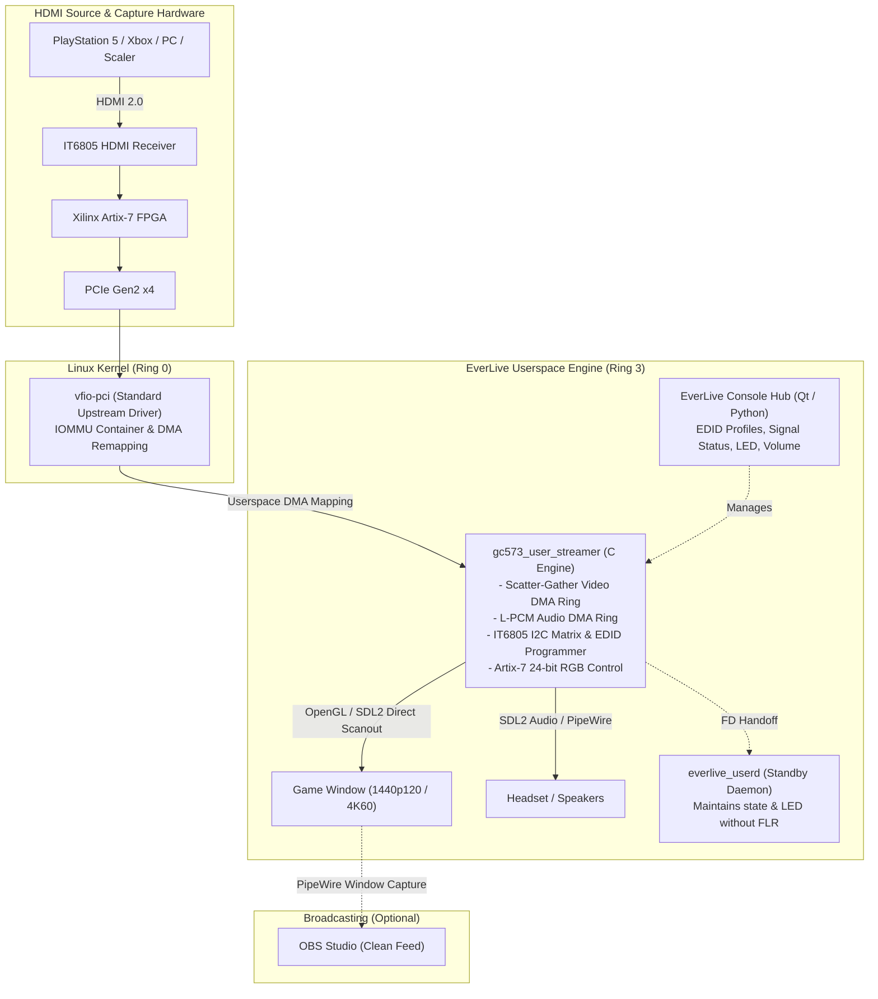

# EverLive - AVerMedia GC573 Linux Gaming Suite & Userspace Driver

[](https://github.com/Everlite/EverLive/releases)
[-brightgreen.svg)](#hardware-verified-capabilities)
[-2e7d32.svg)](#architecture--design)
[](#architecture--design)
[](https://github.com/sponsors/Everlite)
[](https://discord.com/invite/D2XFhkPMmc)
[](#legal-and-licensing)
[](#-transparency--ai-assistance)

**EverLive** is a Linux console gaming suite and open-source userspace driver for the **AVerMedia Live Gamer 4K (GC573)** (`PCI 1461:0054`, Subsystem `1461:5730`).

It is designed to let you play console games (PlayStation 5, Xbox Series X, Nintendo Switch, retro scalers, or secondary PCs) directly on your Linux desktop (Wayland & X11) with low presentation overhead, synchronized uncompressed L-PCM audio, on-the-fly hardware EDID switching, and custom hardware RGB LED control.

---

## Architecture & Design (v1.0.0)

Starting with version 1.0.0, EverLive transitions from an out-of-tree kernel module (`open_gc573`) to a **userspace driver running in Ring 3** via the Linux standard `vfio-pci` subsystem (`tools/opengc573-userd/`).

### Technical Characteristics & Trade-offs
* **No DKMS or Kernel Header Dependencies:** The driver code runs as a standard userspace process. Linux kernel updates (e.g., 6.12 $\rightarrow$ 6.13 $\rightarrow$ 7.x) do not require rebuilding kernel modules.
* **In-Tree Kernel Module (`vfio-pci`):** Uses the standard, upstream `vfio-pci` module shipped and signed by your distribution. It does not load unsigned out-of-tree `.ko` drivers, avoiding kernel-taint flags and custom Machine Owner Key (MOK) enrollment under UEFI Secure Boot.
* **Direct Hardware DMA in Userspace:** Video and audio Scatter-Gather DMA descriptors are mapped directly into userspace process memory via VFIO IOMMU containers, then uploaded directly to an SDL2 OpenGL rendering context.
* **Exclusive Hardware Access (Trade-off):** VFIO requires exclusive binding to the PCI device. When EverLive is running, the card is not exposed as a standard `/dev/video*` (V4L2) or ALSA node to the rest of the system. (See [Streaming with OBS](#-streaming-with-obs) below for the recommended capture workflow).
* **System Requirements:** Requires IOMMU hardware support (`Intel VT-d` or `AMD-Vi / IOMMU`) enabled in your motherboard's UEFI/BIOS. (See [IOMMU & PCIe Groups](#-iommu--pcie-group-requirements)).

> *Note: The legacy kernel module is archived in [`legacy/open_gc573-kernel/`](legacy/open_gc573-kernel/) for historical reference and for setups strictly requiring a native V4L2 device node.*

---

## Hardware-Verified Capabilities

The following capabilities have been physically tested and verified on physical hardware:

* **PlayStation 5:**
  - **2560×1440 @ 120 FPS:** Verified in 120 Hz titles (*The Finals*, *Fortnite 120Hz Mode*, PS5 Dashboard). Stable frame pacing matching display refresh intervals.
  - **3840×2160 @ 60 FPS (Native 4K):** Verified native 4K capture without downscaling stalls.
  - **Audio DMA:** High-fidelity 16-bit / 48kHz L-PCM stereo audio captured over PCIe DMA and played back via SDL2 into PipeWire. No crackling, jitter, or clock drift observed during multi-hour test sessions.
  - **Dynamic Hot-Switching:** Verified dynamic mode changes (e.g., 4K60 dashboard $\leftrightarrow$ 1440p120 gameplay $\leftrightarrow$ 1080p) without process crashes or window recreation.
* **Hardware EDID Profile Injection:**
  - `Default (4K60 / 1440p120 HDR)`: Standard multi-mode EDID profile.
  - `Force 1440p @ 120 Hz`: Enforces high-refresh 120Hz mode negotiation with consoles.
  - `Force 1080p @ 240 Hz`: For high-framerate PC capture.
  - `Load Custom EDID (.bin)`: Writes arbitrary 256-byte binary EDID files directly into the IT6805 HDMI receiver chip over I2C.
* **Retro Scalers & Custom Modelines (RetroTINK 4K Pro):**
  - Verified on physical hardware by contributor [@haxman](https://github.com/haxman): 240p retro modes (`1440x240`, `1920x240` CRT Super-Resolution), 480i / 576i interlaced modes with automatic 4:3 aspect-ratio preservation, PAL 50Hz/100Hz, and Cinema 95.94Hz BFI modes.
* **Hardware RGB LED Lighting:**
  - Native 24-bit RGB control via Artix-7 FPGA register writes. 8 predefined color profiles (or completely disabled). Operates without dropped frames or stream interruptions.
* **Standby Daemon Handoff (`everlive_userd`):**
  - Closing the gaming screen hands off the active file descriptor to a lightweight background daemon without triggering a PCIe Function Level Reset (FLR), preserving the HDMI link state and LED configuration.

*(Note regarding GC555: The Live Gamer BOLT GC555 (`1461:5550`) shares core register layouts, but has not been personally verified on physical hardware by the maintainer.)*

---

## 📺 Streaming with OBS

Because the userspace engine uses `vfio-pci`, the card does not create a `/dev/video*` node. The recommended and lowest-latency workflow for streamers is:

1. **Launch EverLive in Streamer Mode:**  
   Press <kbd>F10</kbd> (or <kbd>s</kbd>), or start with `./play.sh -s` (or enable *Streamer Mode* in the GUI).  
   *In Streamer Mode, all stats overlays, HUD sliders, and mouse cursors are hidden, providing a clean video feed.*
2. **Capture in OBS via PipeWire:**  
   In OBS Studio on Wayland, add a **Window Capture (PipeWire)** source and select the **EverLive** window.
3. **Capture Audio:**  
   In OBS Studio, capture the desktop or PipeWire application audio stream for EverLive.

> **Why this approach?**  
> Playing directly inside the OBS preview window introduces noticeable input lag (usually 50–100 ms+) due to OBS's internal scene compositing and frame queueing. Running EverLive's dedicated SDL2 window allows you to play with minimal display latency while simultaneously passing a clean feed to OBS.  
> *(If your use case strictly requires a raw `/dev/video*` V4L2 device node for a headless streaming rig, please use the legacy kernel driver in [`legacy/open_gc573-kernel/`](legacy/open_gc573-kernel/)).*

---

## ⚙️ IOMMU & PCIe Group Requirements

VFIO relies on hardware-level memory protection provided by your CPU and motherboard chipset.

### 1. Enable IOMMU in UEFI/BIOS
Ensure virtualization and IOMMU support are enabled in your motherboard settings:
* **Intel:** Enable **VT-d** (Virtualization Technology for Directed I/O).
* **AMD:** Enable **AMD-Vi** or **IOMMU**.

### 2. Check IOMMU Grouping
On modern motherboards, PCIe slots are usually isolated into individual IOMMU groups. You can verify your card's group isolation with this command:

```bash
for d in /sys/kernel/iommu_groups/*/devices/*; do
    echo -n "Group $(basename $(dirname $(dirname $d))): "
    lspci -nns $(basename $d)
done | grep -i '1461:'
```

* **Clean Isolation (Typical):** The AVerMedia card is the only device listed in its IOMMU group (apart from PCIe bridge root ports). No further action is required.
* **Shared Group (Rare / Older Boards):** If other endpoint devices (such as a SATA controller or USB controller) share the exact same IOMMU group, VFIO will require all devices in that group to be managed by `vfio-pci`. Alternatively, if your platform lacks ACS isolation, you can test moving the card to a different PCIe slot.

---

## 🚀 Installation & Quickstart

The installer sets up standard userspace dependencies, udev permissions for non-root VFIO access, and memory-locking limits for 4K DMA mapping.

```bash
git clone https://github.com/Everlite/EverLive.git
cd EverLive
sudo ./install.sh
```

### What the installer does:
1. Installs user-level development libraries (`libsdl2-dev`, `python3-pyside6`, `build-essential`, `pciutils`).
2. Configures udev rules (`/etc/udev/rules.d/99-gc573-vfio.rules`) granting your local user read/write access to the card's VFIO group.
3. Sets `/etc/security/limits.d/99-everlive-memlock.conf` and adds `cap_ipc_lock` capabilities so unprivileged users can pin DMA buffers required for native 4K capture.
4. Compiles the userspace binaries (`gc573_user_streamer` and `everlive_userd`).
5. Installs the desktop application launcher.

### Launching:
```bash
./play.sh
```
Or start **EverLive** directly from your desktop application launcher.

---

## Controls & Hotkeys

| Key / Action | Function |
|:---|:---|
| **Mouse Wheel Up / Down** | Adjust audio volume in 5% increments |
| <kbd>m</kbd> | Toggle audio mute |
| <kbd>F11</kbd> or <kbd>f</kbd> (or double-click) | Toggle borderless fullscreen |
| <kbd>s</kbd> or <kbd>F10</kbd> | Toggle **Streamer Mode (Clean Feed)** (hides cursor & HUD for OBS) |
| <kbd>Tab</kbd> or <kbd>i</kbd> | Toggle diagnostic overlay (FPS, latency metrics, jitter) |
| <kbd>Esc</kbd> or <kbd>q</kbd> | Exit the game window |

---

## Architecture Diagram



---

## 💖 Support the Project & Hardware Fund

**EverLive** is an independent, non-commercial open-source project created and maintained by **[Everlite](https://github.com/Everlite)**.

### Why is there a GitHub Sponsors link?
Writing clean-room Linux drivers for proprietary capture hardware requires having the physical cards on the workbench. PCIe capture cards cannot be emulated; reverse-engineering HDMI bridge chips, I2C matrices, and DMA ring descriptors requires register dumping, oscilloscope verification, and testing on real hardware.

**All sponsorship funds are used exclusively to purchase second-hand hardware** (via eBay, Kleinanzeigen, and community sales) to expand open-source Linux capture card support.

#### 🎯 Hardware Acquisition Targets:
* **AVerMedia Live Gamer 4K 2.1 (GC575):** HDMI 2.1 4K144 / 4K120 PCIe capture card.
* **AVerMedia Live Gamer DUO (GC570D):** Dual-channel PCIe capture card.
* **Elgato 4K60 Pro (MK.1 & MK.2) / Cam Link Pro:** Widely used PCIe capture cards currently lacking open-source Linux drivers.

👉 **[Sponsor @Everlite on GitHub Sponsors](https://github.com/sponsors/Everlite)**

---

## Legal and Licensing

| Component | Path | License | Notes |
|:---|:---|:---:|:---|
| **Userspace Driver & Streamer** | `tools/opengc573-userd/` | **GPL-2.0-only** | Userspace VFIO implementation. Copyright © 2026 Everlite. |
| **EverLive Console Hub** | `tools/everlive/`, `play.sh`, `install.sh` | **GPL-2.0-only** | Python/Qt hub and launcher scripts. Copyright © 2026 Everlite. |
| **Legacy Kernel Module** | `legacy/open_gc573-kernel/` | **GPL-2.0-only** | Historical kernel module based on work by ostrich, extended by Everlite. |

### Disclaimers & Trademark Notice
* AVerMedia, Live Gamer 4K (GC573) and Live Gamer BOLT (GC555) are trademarks or registered trademarks of AVerMedia Technologies, Inc. PlayStation, PS4, and PS5 are registered trademarks of Sony Interactive Entertainment Inc. All trademarks belong to their respective owners and are used strictly for compatibility identification. This independent open-source project is not affiliated with, authorized, maintained, sponsored, or endorsed by AVerMedia Technologies, Inc., Sony, or any of their affiliates.
* This software is provided "AS IS", without warranty of any kind. Register configuration and EDID operations are performed at your own risk.

---

## Acknowledgements

- **[@PolygonPrincess](https://github.com/PolygonPrincess)**: For pioneering userspace VFIO control of AVerMedia capture hardware in [OpenGC570D](https://github.com/PolygonPrincess/OpenGC570D), which inspired the architecture of the EverLive v1.0.0 userspace driver.
- **[@haxman](https://github.com/haxman)**: For extensive modeline analysis, RetroTINK 4K Pro hardware testing, and verifying high-refresh and retro video timings.
- **[@ostrich](https://github.com/ostrich)**: Author of the [gc555](https://github.com/ostrich/gc555) driver; his reverse-engineering of the Artix-7 register space laid the foundation for early GC573 open-source development.
- **[@lou-perret](https://github.com/lou-perret)** and **[@derrod](https://github.com/derrod)**: For foundational contributions to open-source capture card research on Linux.

### 🤖 Transparency & AI Assistance
In the spirit of open-source transparency: **this project is heavily AI-assisted**.  
The project owner (Everlite) directed architecture, tested on physical hardware (PlayStation 5, displays, audio sync), analyzed hardware behavior, and validated performance. The implementation, refactoring, and debugging were written and iterated with generative AI / LLM coding agents.
