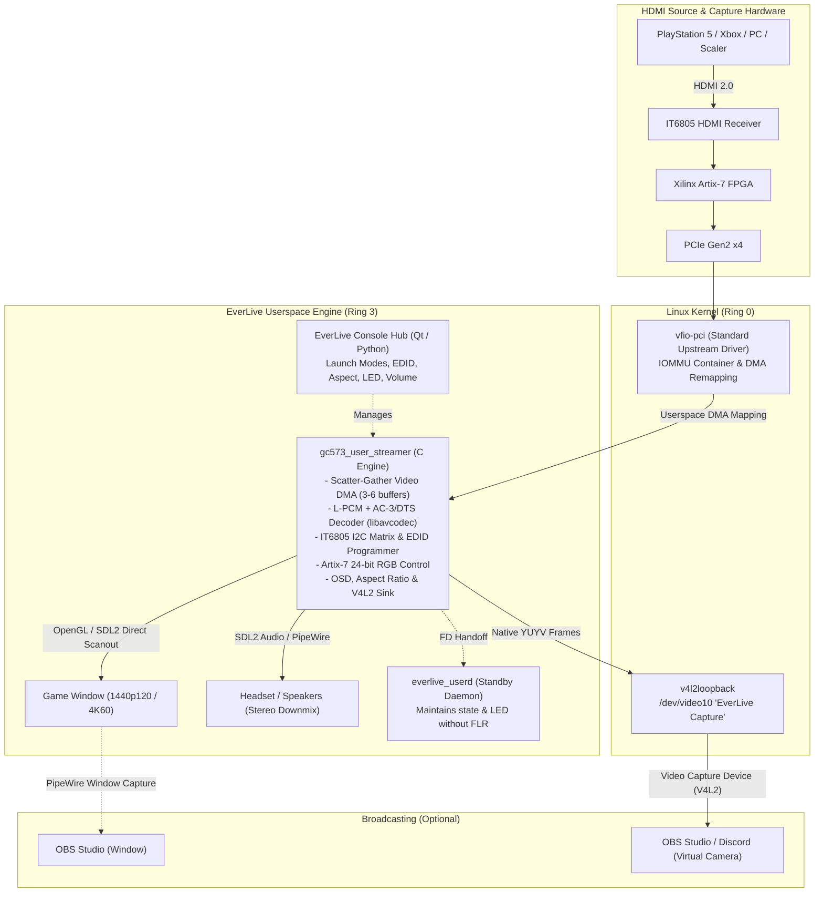

# EverLive - AVerMedia GC573 Linux Gaming Suite & Userspace Driver

[](https://github.com/Everlite/EverLive/releases)
[-brightgreen.svg)](#hardware-verified-capabilities)
[-2e7d32.svg)](#architecture--design)
[](#architecture--design)
[](https://github.com/sponsors/Everlite)
[](https://discord.com/invite/D2XFhkPMmc)
[](#legal-and-licensing)
[](#-transparency--ai-assistance)

**EverLive** is a Linux console gaming suite and open-source userspace driver for the **AVerMedia Live Gamer 4K (GC573)** (`PCI 1461:0054`, Subsystem `1461:5730`).

It is designed to let you play console games (PlayStation 5, Xbox Series X, Nintendo Switch, retro scalers, or secondary PCs) directly on your Linux desktop (Wayland & X11) with low presentation overhead, synchronized audio (**Linear PCM** as well as **Dolby Digital / DTS 5.1** decoded to stereo), a native **V4L2 virtual camera** for OBS/Discord, on-the-fly hardware EDID switching, and custom hardware RGB LED control.

---

## Architecture & Design

Starting with version 1.0.0, EverLive transitions from an out-of-tree kernel module (`open_gc573`) to a **userspace driver running in Ring 3** via the Linux standard `vfio-pci` subsystem (`tools/opengc573-userd/`).

### Technical Characteristics & Trade-offs
* **No DKMS or Kernel Header Dependencies:** EverLive's capture engine runs 100% in userspace with zero kernel modules or DKMS rebuilds. The optional Virtual Camera sink uses your distribution's upstream `v4l2loopback` package; you can opt out during installation with `./install.sh --no-loopback` to keep your system entirely module-free.
* **In-Tree Kernel Module (`vfio-pci`):** Uses the standard, upstream `vfio-pci` module shipped and signed by your distribution. It does not load unsigned out-of-tree `.ko` drivers, avoiding kernel-taint flags and custom Machine Owner Key (MOK) enrollment under UEFI Secure Boot.
* **Direct Hardware DMA in Userspace:** Video and audio Scatter-Gather DMA descriptors are mapped directly into userspace process memory via VFIO IOMMU containers, then uploaded directly to an SDL2 OpenGL rendering context.
* **Exclusive Hardware Access & Virtual Camera:** VFIO requires exclusive binding to the PCI device. Starting in v1.2.0, EverLive includes a native virtual camera sink (`/dev/video10` labeled `"EverLive Capture"` via `v4l2loopback`), delivering clean, unscaled raw frames to OBS, Discord, and FFmpeg simultaneously with the gaming screen or in Headless Studio mode.
* **System Requirements:** Requires IOMMU hardware support (`Intel VT-d` or `AMD-Vi / IOMMU`) enabled in your motherboard's UEFI/BIOS. (See [IOMMU & PCIe Groups](#-iommu--pcie-group-requirements)).

> *Note: The legacy kernel module is archived in [`legacy/open_gc573-kernel/`](legacy/open_gc573-kernel/) for historical reference.*

---

## Hardware-Verified Capabilities

The following capabilities have been physically tested and verified on physical hardware:

> Items marked **(v1.2.0)** were verified on physical hardware with a PlayStation 5:
> 1440p120 capture, the OBS virtual camera (`/dev/video10`), the Gaming $\leftrightarrow$ Studio
> handover, and Dolby Digital / DTS decoding.

* **PlayStation 5:**
  - **2560×1440 @ 120 FPS:** Verified in 120 Hz titles (*The Finals*, *Fortnite 120Hz Mode*, PS5 Dashboard). Stable frame pacing matching display refresh intervals.
  - **3840×2160 @ 60 FPS (Native 4K):** Verified native 4K capture without downscaling stalls.
  - **Audio DMA & Universal Bitstream Decoding:** High-fidelity audio captured over PCIe DMA and played back via SDL2 into PipeWire. Supports both uncompressed **Linear PCM** (up to 8 channels) and compressed **Dolby Digital (AC-3 5.1)** and **DTS (5.1)** bitstreams decoded in real time via `libavcodec` and downmixed to stereo with `libswresample`. Failsafe mute-guard prevents digital noise during mode transitions.
  - **Dynamic Hot-Switching:** Verified dynamic mode changes (e.g. 4K60 dashboard $\leftrightarrow$ 1440p120 gameplay $\leftrightarrow$ 1080p) without process crashes or window recreation.
* **Virtual Camera & Studio Mode (v1.2.0):**
  - **Native V4L2 output:** Verified with a PS5 at 1440p120 feeding OBS through `/dev/video10` (`"EverLive Capture"`) while the interactive gaming window is open.
  - **Headless Studio:** The same 1440p120 feed without an SDL window; switching between Gaming Screen and Studio Mode completes without restarting EverLive.
  - **OBS-safe renegotiation:** Resolution changes while OBS holds its buffers resume automatically once OBS renegotiates.
* **Hardware EDID Profile Injection (Universal Audio Support — v1.2.0):**
  - All standard built-in profiles natively advertise **Linear PCM**, **Dolby Digital (AC-3)**, and **DTS 5.1** Short Audio Descriptors (SADs), allowing consoles to output surround audio automatically without manual profile switching.
  - `Default (4K60 / 1440p120 HDR)`: Standard multi-mode EDID profile.
  - `Force 1440p @ 120 Hz`: Prioritizes 1440p high-refresh modes for consoles by omitting 4K descriptors.
  - `Force 1080p @ 240 Hz`: For high-framerate PC capture.
  - `Load Custom EDID (.bin)`: Writes validated 256-byte binary EDID files (header & CEA checksum verified) directly into the IT6805 HDMI receiver chip over I2C upon stream launch.
* **Retro Scalers & Custom Modelines (RetroTINK 4K Pro):**
  - Verified on physical hardware by contributor [@haxman](https://github.com/haxman): 240p retro modes (`1440x240`, `1920x240` CRT Super-Resolution), 480i / 576i interlaced modes with automatic 4:3 aspect-ratio preservation, PAL 50Hz/100Hz, and Cinema 95.94Hz BFI modes.
* **Hardware RGB LED Lighting:**
  - Native 24-bit RGB control via Artix-7 FPGA register writes. 8 predefined color profiles (or completely disabled). Operates without dropped frames or stream interruptions.
* **Standby Daemon Handoff (`everlive_userd`):**
  - Closing the gaming screen hands off the active file descriptor to a lightweight background daemon without triggering a PCIe Function Level Reset (FLR), preserving the HDMI link state and LED configuration.

### 🎧 Custom EDID Requirements & Audio Unification

Custom EDIDs loaded via `--edid /path/to/custom.bin` (or the Control Hub's *Load Custom EDID (.bin)...*) must be exactly **256 bytes** — one base block plus one CTA-861 extension block — and pass EverLive's header and checksum validation.

Unless `--raw-edid` is given, EverLive rewrites the CTA-861 Audio Data Block of the custom file so it advertises **L-PCM (8 ch), Dolby Digital (AC-3 5.1) and DTS 5.1**, exactly like the built-in profiles. Files that carry no audio block at all get a complete audio block appended.

- **Spare budget:** replacing an existing L-PCM-only audio block needs **6 spare bytes** in the extension block; appending a new audio block needs **10 bytes**. EverLive reclaims the optional Video Capability Data Block (3 bytes) if that is the only way to keep every detailed timing.
- **Fallback:** if the extension block is completely full, the file is used unmodified and the streamer logs `[EDID] Using raw audio block from '…' (unification bypassed: no space for SADs)`.
- **Opt-out:** `--raw-edid` (alias `--no-unify-edid`) loads the file **bit-exact**, e.g. for debugging or vendor-specific EDIDs.

---

## 🎬 Video Demonstration (1-Click Launch & PS5 120 FPS Gameplay)

Watch EverLive v1.0.0 in action on Linux: launching directly from the desktop application launcher, transitioning to the PlayStation 5 dashboard, and loading into *The Finals* at **1440p @ 120 FPS** with low latency and synchronous audio playback *(embedded video below is compressed for GitHub's 10 MB web-embed limit; full-bitrate 1440p120 file available in [Releases](https://github.com/Everlite/EverLive/releases/tag/v1.0.0))*:

https://github.com/user-attachments/assets/19932c79-5364-4f16-81cf-0187f741129c

---

## 📺 Streaming & Recording with OBS

Starting with version 1.2.0, EverLive supports **native V4L2 Loopback output** directly from its blob-free userspace engine, giving you three distinct workflows:

### Option 1: Native Virtual Camera (`/dev/video10`) — *Recommended*
EverLive streams raw YUYV capture frames directly to a virtual video device node (`/dev/video10` labeled `"EverLive Capture"`):
1. **Enable in Control Hub:** Check the `Virtual Camera (OBS /dev/video10)` checkbox in EverLive Hub (or launch with `./play.sh --loopback`).
2. **Add to OBS Studio:** Add a standard **Video Capture Device (V4L2)** source, select `EverLive Capture (/dev/video10)`, and set Resolution to **Device Default** (or matching your console, e.g. 1920×1080 / 2560×1440).
3. **Capture Audio:** Add an **Audio Input Capture (PulseAudio/PipeWire)** source and select the EverLive HDMI audio stream.

> [!TIP]
> **OBS & EverLive Launch Order & Source Refresh:**  
> EverLive automatically handles format negotiation with OBS:
> * **EverLive opened first, then OBS:** OBS connects immediately at the full native resolution (e.g. 1440p or 4K).
> * **OBS opened first, then EverLive:** If OBS was already open before EverLive started, OBS's V4L2 capture thread may pause while waiting for initial frames. In OBS, simply click on the Video Capture source properties or toggle the source visibility ($👁$) to refresh the feed — EverLive's built-in on-the-fly scaler (`libswscale`) will automatically adopt and fit the frames into OBS's active canvas without dropping.

> [!NOTE]
> **Standby & "No Signal" Screen (v1.2.2):**  
> When your console is powered off or during HDMI handshakes, EverLive automatically pumps a clean 30 FPS "No Signal" standby card to both the game window and `/dev/video10`. This prevents OBS from freezing on a black or corrupted frame during signal loss.

> [!NOTE]
> **Prerequisite:** `install.sh` installs `v4l2loopback` where your distribution packages it and preconfigures it (`/etc/modprobe.d/everlive-v4l2loopback.conf` + `/etc/modules-load.d/`). If the module is not packaged (e.g. Fedora without RPM Fusion), install your distribution's `v4l2loopback-dkms` once — `play.sh` loads it with `video_nr=10 card_label="EverLive Capture" exclusive_caps=0` when the node is missing.

> [!TIP]
> **Simultaneous 1440p120 Gaming & 4K OBS Recording:**  
> If you game at 1440p @ 120 FPS, set your OBS canvas/output to 4K (3840×2160) and right-click the EverLive V4L2 source $\to$ *Transform $\to$ Fit to Screen*. OBS will hardware-upscale the native 1440p120 feed to 4K in real time for crisp YouTube uploads with the high-bitrate VP9/AV1 codec!

### Option 2: Studio / Headless Mode (Zero Display Overhead)
If you play directly on a TV or secondary monitor connected to the GC573's **HDMI OUT (Hardware Passthrough)**, you do not need an open game window on your PC desktop:
* Click **`Start Studio / Headless (OBS)`** in the Hub (or run `./play.sh --loopback --headless`).
* EverLive runs silently in the background, consuming minimal CPU/GPU resources while delivering unscaled frames to OBS and playing HDMI audio.
* Seamlessly toggle between Gaming Screen and Studio Mode at any time using the on-the-fly mode switcher.

### Option 3: Direct Wayland Window Capture (PipeWire)
If you prefer not to use `v4l2loopback`, you can still capture the interactive game window directly in OBS Studio via **Window Capture (PipeWire)**.

---

## ⚙️ IOMMU & PCIe Group Requirements

VFIO relies on hardware-level memory protection provided by your CPU and motherboard chipset.

### 1. Enable IOMMU in UEFI/BIOS
Ensure virtualization and IOMMU support are enabled in your motherboard settings:
* **Intel:** Enable **VT-d** (Virtualization Technology for Directed I/O).
* **AMD:** Enable **AMD-Vi** or **IOMMU**.

### 2. Enable IOMMU in the Linux Kernel Command Line
Enabling VT-d / AMD-Vi in your UEFI/BIOS is necessary, but **not always sufficient**. Many Linux distributions leave secondary PCIe slots unmanaged by the IOMMU unless explicitly commanded at boot.

Add the following parameter to your bootloader (e.g. GRUB):
* **Intel:** `intel_iommu=on iommu=pt`
* **AMD:** `amd_iommu=on iommu=pt`

#### How to configure GRUB:
1. Edit `/etc/default/grub`:
   ```bash
   sudo nano /etc/default/grub
   ```
2. Append the parameter to `GRUB_CMDLINE_LINUX_DEFAULT`:
   ```text
   GRUB_CMDLINE_LINUX_DEFAULT="... intel_iommu=on iommu=pt"
   ```
3. Update GRUB and reboot:
   ```bash
   # Ubuntu / Debian / Mint
   sudo update-grub

   # Arch / Fedora / CachyOS
   sudo grub-mkconfig -o /boot/grub/grub.cfg

   sudo reboot
   ```

> [!TIP]
> **Symptom if missing:** The card blinks red, and running `dmesg | grep -i vfio` shows:  
> `vfio-pci ...: probe with driver vfio-pci failed with error -22`  
> *(Error -22 / -EINVAL means the Linux kernel has not allocated an IOMMU group for this PCIe slot).*

### 3. Check IOMMU Grouping
On modern motherboards, PCIe slots are usually isolated into individual IOMMU groups. You can verify your card's group isolation with this command:

```bash
for d in /sys/kernel/iommu_groups/*/devices/*; do
    echo -n "Group $(basename $(dirname $(dirname $d))): "
    lspci -nns $(basename $d)
done | grep -i '1461:'
```

* **Clean Isolation (Typical):** The AVerMedia card is the only device listed in its IOMMU group (apart from PCIe bridge root ports). No further action is required.
* **Shared Group (Rare / Older Boards):** If other endpoint devices (such as a SATA controller or USB controller) share the exact same IOMMU group, VFIO will require all devices in that group to be managed by `vfio-pci`. Alternatively, if your platform lacks ACS isolation, you can test moving the card to a different PCIe slot.

---

## 🚀 Installation & Quickstart

The installer sets up standard userspace dependencies, udev permissions for non-root VFIO access, and memory-locking limits for 4K DMA mapping.

```bash
git clone https://github.com/Everlite/EverLive.git
cd EverLive
sudo ./install.sh
```

### 🧊 Strictly module-free setup (no loopback)
If you chose EverLive for its module-free architecture and want to keep the system completely free of DKMS modules and kernel headers, skip the optional Virtual Camera:

```bash
sudo ./install.sh --no-loopback
```

`--skip-loopback` is an alias, and `sudo ./install.sh --help` lists all options. Without `v4l2loopback`, `/dev/video10` is unavailable — capture the game window via PipeWire instead (see [Streaming & Recording with OBS](#-streaming--recording-with-obs)). Re-running the installer without the flag re-enables the Virtual Camera.

### What the installer does:
1. Installs the build/runtime dependencies: SDL2, FFmpeg development libraries (`libavcodec`/`libswresample`/`libavutil`), `libcap` (`setcap`), WirePlumber (`wpctl`), `xcb-util-cursor`, PySide6, standard build tools, and `v4l2loopback` where the distribution packages it (skip with `--no-loopback`).
2. Configures udev rules (`/etc/udev/rules.d/70-everlive.rules`) granting your local user read/write access to the card's VFIO group and binding `vfio-pci`.
3. Sets `/etc/security/limits.d/99-everlive-memlock.conf` and adds `cap_ipc_lock` capabilities so unprivileged users can pin DMA buffers required for native 4K capture.
4. Blacklists the legacy out-of-tree `open_gc573` module (`/etc/modprobe.d/blacklist-everlive-legacy.conf`) so it cannot race with `vfio-pci` at boot.
5. Compiles the userspace binaries (`gc573_user_streamer`, `everlive_userd`, `gc573_user_probe`).
6. Installs the desktop application launcher and icon.
7. Configures the Virtual Camera: `/etc/modprobe.d/everlive-v4l2loopback.conf` (`video_nr=10 card_label="EverLive Capture" exclusive_caps=0`) and loads the module at boot via `/etc/modules-load.d/`.

### Launching:
```bash
./play.sh

# Or launch directly hidden into the system tray:
./play.sh --tray
```
Or start **EverLive** directly from your desktop application launcher.

### 🔄 Updating EverLive:
```bash
git pull
./play.sh
```
*EverLive's launcher (`play.sh`) automatically detects modified source files and incrementally recompiles the userspace binaries on startup.*

---

## Controls & Hotkeys

| Key / Action | Function |
|:---|:---|
| <kbd>f</kbd> or <kbd>F11</kbd> | Toggle borderless fullscreen |
| <kbd>a</kbd> | Cycle Aspect Ratio (`auto` $\to$ `16:9` $\to$ `4:3` $\to$ `stretch`) |
| <kbd>p</kbd> | Cycle OSD position (Top-Right $\to$ Bottom-Right $\to$ Bottom-Left $\to$ Top-Left; default Top-Right) |
| <kbd>o</kbd>, <kbd>i</kbd> or <kbd>Tab</kbd> | Toggle the on-screen stats overlay |
| <kbd>s</kbd> or <kbd>F10</kbd> | Toggle overlay and mouse cursor (Streamer Mode toggle; `--streamer-mode` starts with both hidden) |
| <kbd>Esc</kbd> or <kbd>q</kbd> | Exit the game window |

*VSync is a launch option (`--vsync` / Hub checkbox) and cannot be toggled while streaming. Volume and mute are controlled through the EverLive Console Hub, your system audio mixer, or PipeWire.*

---

## Architecture Diagram



---

## 💖 Support the Project & Hardware Fund

**EverLive** is an independent, non-commercial open-source project created and maintained by **[Everlite](https://github.com/Everlite)**.

### Why is there a GitHub Sponsors link?
Writing clean-room Linux drivers for proprietary capture hardware requires having the physical cards on the workbench. PCIe capture cards cannot be emulated; reverse-engineering HDMI bridge chips, I2C matrices, and DMA ring descriptors requires register dumping, oscilloscope verification, and testing on real hardware.

**All sponsorship funds are used exclusively to purchase second-hand hardware** (via eBay, Kleinanzeigen, and community sales) to expand open-source Linux capture card support.

#### 🎯 Hardware Acquisition Targets:
* **AVerMedia Live Gamer 4K 2.1 (GC575):** HDMI 2.1 4K144 / 4K120 PCIe capture card.
* **AVerMedia Live Gamer DUO (GC570D):** Dual-channel PCIe capture card.
* **Elgato 4K60 Pro (MK.1 & MK.2) / Cam Link Pro:** Widely used PCIe capture cards currently lacking open-source Linux drivers.

👉 **[Sponsor @Everlite on GitHub Sponsors](https://github.com/sponsors/Everlite)**

---

## Legal and Licensing

| Component | Path | License | Notes |
|:---|:---|:---:|:---|
| **Userspace Driver & Streamer** | `tools/opengc573-userd/` | **GPL-2.0-only** | Userspace VFIO implementation. Copyright © 2026 Everlite. |
| **EverLive Console Hub** | `tools/everlive/`, `play.sh`, `install.sh` | **GPL-2.0-only** | Python/Qt hub and launcher scripts. Copyright © 2026 Everlite. |
| **Legacy Kernel Module** | `legacy/open_gc573-kernel/` | **GPL-2.0-only** | Historical kernel module based on work by ostrich, extended by Everlite. |

### Disclaimers & Trademark Notice
* AVerMedia, Live Gamer 4K (GC573) and Live Gamer BOLT (GC555) are trademarks or registered trademarks of AVerMedia Technologies, Inc. PlayStation, PS4, and PS5 are registered trademarks of Sony Interactive Entertainment Inc. All trademarks belong to their respective owners and are used strictly for compatibility identification. This independent open-source project is not affiliated with, authorized, maintained, sponsored, or endorsed by AVerMedia Technologies, Inc., Sony, or any of their affiliates.
* This software is provided "AS IS", without warranty of any kind. Register configuration and EDID operations are performed at your own risk.

---

## Acknowledgements

- **[@PolygonPrincess](https://github.com/PolygonPrincess)**: For pioneering userspace VFIO control of AVerMedia capture hardware in [OpenGC570D](https://github.com/PolygonPrincess/OpenGC570D), which inspired the architecture of the EverLive v1.0.0 userspace driver.
- **[@haxman](https://github.com/haxman)**: For extensive modeline analysis, RetroTINK 4K Pro hardware testing, and verifying high-refresh and retro video timings.
- **[@ostrich](https://github.com/ostrich)**: Author of the [gc555](https://github.com/ostrich/gc555) driver; his reverse-engineering of the Artix-7 register space laid the foundation for early GC573 open-source development.
- **[@lou-perret](https://github.com/lou-perret)**: Author of the historic breakthroughs in PRs [#7](https://github.com/Everlite/Avermedia-GC573-Linux/pull/7) and [#8](https://github.com/Everlite/Avermedia-GC573-Linux/pull/8) (continuous capture pipeline, DMA sync, and audio constraints) that turned static DMA filler into the very first live, watchable video picture from the GC573 on Linux.
- **[@derrod](https://github.com/derrod)**: For early Linux reverse-engineering work and documentation on AVerMedia capture hardware.

### 🤖 Transparency & AI Assistance
In the spirit of open-source transparency: **this project is heavily AI-assisted**.  
The project owner (Everlite) directed architecture, tested on physical hardware (PlayStation 5, displays, audio sync), analyzed hardware behavior, and validated performance. The implementation, refactoring, and debugging were written and iterated with generative AI / LLM coding agents.
