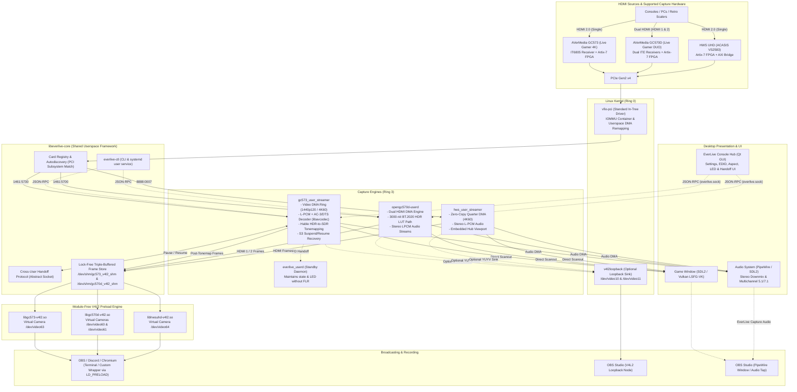

# EverLive - Linux Console Gaming Suite & Userspace Driver (GC573 · GC570D · HWS UHD · GC553G2)

[](https://github.com/Everlite/EverLive/releases)
[-brightgreen.svg)](#hardware-verified-capabilities)
[-2e7d32.svg)](#architecture--design)
[](#architecture--design)
[](https://github.com/sponsors/Everlite)
[](https://discord.com/invite/D2XFhkPMmc)
[](#legal-and-licensing)
[](#-transparency--ai-assistance)

**EverLive** is a Linux console gaming suite and open-source userspace driver for the **AVerMedia Live Gamer 4K (GC573)** (`PCI 1461:0054`, Subsystem `1461:5730`), the **Live Gamer DUO (GC570D)** (`PCI 1461:0054`, Subsystem `1461:5700`), and the **HWS UHD capture card family (ACASIS VS2583 / AVMatrix VC12-4K)** (`PCI 8888:8581` / `1f33:8581`, Subsystem `0007`), with experimental USB/UVC control support for the **Live Gamer ULTRA 2.1 (GC553G2)** (`USB 07ca:2553`, community-tested). Installed PCIe cards are automatically detected through PCI `subsystem_device` and routed to the matching VFIO engine, while the GC553G2 uses standard `uvcvideo` plus USB/HID controls.

It is designed to let you play console games (PlayStation 5, Xbox Series X, Nintendo Switch, retro scalers, or secondary PCs) directly on your Linux desktop (Wayland & X11) with low presentation overhead, real-time **HDR10 / HLG to SDR filmic tonemapping**, synchronized audio (**Linear PCM 2.0 / 5.1 / 7.1** multichannel passthrough as well as **Dolby Digital / DTS 5.1** with standardized **ITU-R BS.775 downmixing** for stereo headsets), a native **V4L2 virtual camera** and **PipeWire virtual audio track** for OBS/Discord, zero-interruption live runtime controls over IPC, **pixel-perfect integer scaling** for retro and 720p/1080p consoles, selectable hardware EDID profiles (switchable live over IPC or on session launch), and custom hardware RGB LED control.

The **Live Gamer DUO** additionally exposes both HDMI inputs simultaneously: HDMI 1 supports the full 3000-nit BT.2020 HDR LUT path and native lower resolutions, HDMI 2 is published as a second OBS camera, and validated stereo LPCM capture (with multichannel passthrough to HDMI OUT) is available from both inputs. When multiple supported capture cards are installed, EverLive's built-in **Capture Card Selector** allows switching between them seamlessly within the Console Hub.

> **Quick Navigation:** [Installation & Quickstart](#-installation--quickstart) · [Controls & Hotkeys](#controls--hotkeys) · [OBS Streaming Setup](#-streaming--recording-with-obs) · [IOMMU & BIOS Setup](#-iommu--pcie-group-requirements) · [Live Gamer DUO (GC570D)](#live-gamer-duo-gc570d) · [GC553G2 (USB/UVC)](#live-gamer-ultra-21-gc553g2) · [HWS UHD (ACASIS VS2583)](#hws-uhd-acasis-vs2583) · [Frame Gen 2x/3x/4x & Native FG](#frame-generation-2x--3x--4x--lsfg-vk) · [Hardware-Verified Capabilities](#hardware-verified-capabilities) · [Architecture & Diagram](#architecture--design) · [Contributing](#-contributing--adding-new-cards) · [License](#legal-and-licensing)

---

## 🚀 Installation & Quickstart

The installer sets up standard userspace dependencies, udev permissions for non-root VFIO access, and memory-locking limits for 4K DMA mapping.

```bash
git clone https://github.com/Everlite/EverLive.git
cd EverLive
sudo ./install.sh
```

> **Note:** VFIO requires IOMMU (`Intel VT-d` or `AMD-Vi`) enabled in UEFI/BIOS and on the kernel command line. If the card is not detected on first launch, see [IOMMU & PCIe Group Requirements](#-iommu--pcie-group-requirements).

### Launching:
```bash
./play.sh

# Or launch directly hidden into the system tray:
./play.sh --tray
```
Or start **EverLive** directly from your desktop application launcher.

### 🔄 Updating EverLive:
```bash
git pull
./play.sh
```
*EverLive's launcher (`play.sh`) automatically detects modified source files and incrementally recompiles the userspace binaries on startup. Rebuilding replaces the binaries and clears their `cap_ipc_lock` file capability; the launcher re-applies it automatically when needed (one authorization prompt).*

### 🧊 Strictly module-free setup (no loopback)
If you chose EverLive for its module-free architecture and want to keep the system completely free of DKMS modules and kernel headers, skip the optional Virtual Camera:

```bash
sudo ./install.sh --no-loopback
```

`--skip-loopback` is an alias, and `sudo ./install.sh --help` lists all options. Without `v4l2loopback`, `/dev/video10` is unavailable — capture via the module-free preload libraries (`libgc573-v4l2.so` / `libgc570d-v4l2.so`) or PipeWire window capture instead (see [Streaming & Recording with OBS](#-streaming--recording-with-obs)). Add `--with-preload` to create `(EverLive Camera)` launchers for Discord, OBS and supported browsers at the same time. Re-running the installer without the flag re-enables the system-wide loopback nodes.

### Building, testing, and system packaging
```bash
make -j"$(nproc)"                                       # libeverlive-core + AVerMedia engines + VK pacer (optional: make hwsuhd)
make test                                              # 11 C unit-test suites (alias: make -C tests test)
python3 -m unittest discover -s tools/everlive/tests -v # Python Console Hub & GC553G2 unit tests
make asan                                              # AddressSanitizer + UBSan run (alias: make -C tests asan)
sudo make install                                      # optional system-wide install (PREFIX=/usr/local, installs 'everlive' launcher)
```

`./build.sh` is a thin wrapper around the top-level `make`. Arch Linux `PKGBUILD` files (`everlive` and `everlive-git`) are provided in [`packaging/arch/`](packaging/arch/).

### What the installer does:
1. Installs the build/runtime dependencies: SDL2 + SDL2_ttf, FFmpeg development libraries (`libavcodec`/`libswresample`/`libswscale`/`libavutil`), `libcap` (`setcap`), PipeWire/WirePlumber, `xcb-util-cursor`, PySide6, standard build tools, optional `lsfg-vk` frame generation layer (skip with `--no-framegen`), and `v4l2loopback` where packaged (skip with `--no-loopback`).
2. Configures udev rules (`/etc/udev/rules.d/70-everlive.rules`) and early-boot VFIO autobind (`/etc/modules-load.d/everlive-vfio.conf` + `/etc/modprobe.d/everlive-vfio.conf`) granting your local user read/write access to PCIe VFIO groups, binding `vfio-pci`, and granting non-root USB/HID access to the GC553G2 (`07ca:2553` / `07ca:d553`).
3. Sets `/etc/security/limits.d/99-everlive-memlock.conf` and adds `cap_ipc_lock` capabilities so unprivileged users can pin DMA buffers required for native 4K and dual-HDMI capture.
4. Blacklists the legacy out-of-tree `open_gc573` module (`/etc/modprobe.d/blacklist-everlive-legacy.conf`) so it cannot race with `vfio-pci` at boot.
5. Compiles the shared core and userspace engines through the top-level `Makefile`: `libeverlive-core` (`everlive-ctl`, `libeverlive_core.so`), `opengc573-userd` (`gc573_user_streamer`, `everlive_userd`, `gc573_user_probe`, `gc573_user_diag`, `libgc573-v4l2.so`, `libeverlive-vk-pacer.so`) and `opengc570d-userd` (`opengc570d-userd`, `gc570d-ctl`, `libgc570d-v4l2.so`); the HWS UHD engine (`tools/openhws-userd`) is built on demand (`make hwsuhd`) or automatically via `play.sh` when an HWS UHD card is selected. The core library, its headers, `everlive-ctl`, `everlive-service`, the module-free V4L2 preload libraries, the Vulkan pacer library, and the universal `everlive.service` unit are installed system-wide.
6. Configures an isolated PipeWire audio sink (`50-everlive-capture.conf`) providing the dedicated `"EverLive Capture Audio"` source for OBS.
7. *(Unless `--no-loopback` is requested)* Configures the Virtual Camera loopback nodes: `/etc/modprobe.d/everlive-v4l2loopback.conf` (`video_nr=10,11 card_label="EverLive Capture,EverLive Capture HDMI 2" exclusive_caps=0`) and loads the module at boot via `/etc/modules-load.d/`.
8. Installs the desktop application launcher and icon.
9. *(Optional, `--with-preload`)* Creates reversible **`<App> (EverLive Camera)`** application-menu launchers for supported native apps (Discord, OBS, Chrome, Chromium, Brave, Firefox and Zoom). Each entry starts that app with the card-specific `LD_PRELOAD` virtual camera; existing launchers and user overrides are left untouched.

*(To cleanly remove EverLive and revert all system configurations, run `sudo ./uninstall.sh`).*

---

## Controls & Hotkeys

| Key / Action | Function |
|:---|:---|
| <kbd>f</kbd> or <kbd>F11</kbd> | Toggle borderless fullscreen |
| <kbd>1</kbd> or <kbd>l</kbd> *(GC573)* / <kbd>l</kbd> *(GC570D)* | Toggle scaling mode (`fit` bilinear $\to$ `integer` nearest-neighbor) |
| <kbd>1</kbd> / <kbd>2</kbd> *(GC570D only)* | Select HDMI IN 1 / HDMI IN 2 |
| <kbd>p</kbd> *(GC570D)* | Toggle Picture-in-Picture (PiP) of the secondary HDMI input |
| <kbd>g</kbd> *(GC573)* | Cycle Frame Generation multiplier (`Off` $\to$ `2×` $\to$ `3×` $\to$ `4×` $\to$ `Off`) |
| <kbd>h</kbd> *(GC573)* | Toggle real-time HDR10 / HLG $\to$ SDR filmic tonemapping |
| <kbd>a</kbd> | Cycle Aspect Ratio (`auto` $\to$ `16:9` $\to$ `4:3` $\to$ `stretch`) |
| <kbd>↑</kbd> / <kbd>↓</kbd> (or <kbd>+</kbd> / <kbd>-</kbd>) | Volume up / down (in 5% steps) |
| <kbd>m</kbd> | Toggle audio mute |
| <kbd>F1</kbd> or <kbd>?</kbd> *(GC573)* | Toggle on-screen hotkey help overlay |
| <kbd>p</kbd> *(GC573/HWS)* / <kbd>c</kbd> *(GC570D)* | Toggle the OSD bar between Top and Bottom (default Top) |
| <kbd>o</kbd>, <kbd>i</kbd> or <kbd>Tab</kbd> | Toggle the on-screen stats overlay |
| <kbd>s</kbd> or <kbd>F10</kbd> *(GC573)* | Toggle overlay and mouse cursor (Streamer Mode toggle; `--streamer-mode` starts with both hidden) |
| <kbd>Esc</kbd> or <kbd>q</kbd> | Exit Cinema Fullscreen (embedded mode) or exit pop-out window (in embedded Hub mode, <kbd>q</kbd> exits fullscreen without terminating the background service) |

When the OSD is enabled, the identity/control **bar** is the normal readout for GC573, GC570D and HWS UHD in the embedded Hub feed, pop-out window and fullscreen. It is a single horizontal strip centred at the top or bottom of the video: live dot, card name, an optional two-icon HDMI input button, Aspect, Scale, and the Record, PiP, volume, mute, fullscreen and Hide overlay controls. The HDMI, Aspect, Scale, PiP, Record, volume, mute, fullscreen and Hide overlay controls are clickable; they highlight on hover and show their keyboard shortcut in a tooltip beneath the control. Notifications appear just below a top bar or just above a bottom bar. Hovering the live dot or card name shows the mockup's compact signal pill (`1080p60 • YUYV • 2 ch 48000 Hz`). The HDMI button shows both inputs and highlights the active one; Aspect and Scale are icon buttons whose bespoke ratio/pixel diagrams change with the active mode. Their tooltips show the active HDMI input, aspect ratio or scaling mode. The live dot and volume slider are rendered with smooth glyph/antialiased output. Actions raise OSD toasts, and fullscreen requests from the embedded card are forwarded to the Hub. Record mirrors the Hub take and starts or stops it from the card. Embedded sessions poll the X11 pointer directly, so bar clicks keep working after Cinema Fullscreen or a detach/reattach cycle. <kbd>Tab</kbd>/<kbd>O</kbd> hides it; Multiview tiles keep their OSD disabled and use the tile header for status. Use `everlive-ctl runtime osd-mode compact` if you prefer the old compact stats line, or set `EVERLIVE_OSD_DEBUG=1` to trace bar geometry and click hits.

*VSync is a launch option (`--vsync` / Hub checkbox) and cannot be toggled while streaming. Volume, mute, and scaling can also be controlled through the EverLive Console Hub GUI.*

---

## 🎬 Video Demonstration (1-Click Launch & PS5 120 FPS Gameplay)

Watch EverLive in action on Linux: launching directly from the desktop application launcher, transitioning to the PlayStation 5 dashboard, and loading into *The Finals* at **1440p @ 120 FPS** with low latency and synchronous audio playback *(embedded video below is compressed for GitHub's 10 MB web-embed limit; full-bitrate 1440p120 file available in [Releases](https://github.com/Everlite/EverLive/releases))*:

https://github.com/user-attachments/assets/19932c79-5364-4f16-81cf-0187f741129c

---

## 📺 Streaming & Recording with OBS

Starting with version 1.2.0, EverLive supports flexible video broadcasting across four distinct workflows, allowing you to choose the balance between desktop integration and a strictly module-free setup:

### Option 1: System-Wide Loopback Sink (`/dev/video10` & `/dev/video11`) — *Standard Desktop Integration*
Creates standard system-wide V4L2 device nodes visible to any application (OBS Studio, Discord, web browsers) launched normally from your application menu:
1. **Enable in Control Hub:** Check `V4L2 Loopback (/dev/video10)` (and optionally `Virtual Audio Track`) in EverLive Hub, or launch with `./play.sh --loopback --audio-tap`.
2. **Add to OBS Studio:** Add a standard **Video Capture Device (V4L2)** source, select `EverLive Capture (/dev/video10)`, and set Resolution to **Device Default** (or matching your console, e.g. 1920×1080 / 2560×1440).
3. **Capture Isolated Game Audio:** Add an **Audio Input Capture (PipeWire)** source and select **`Monitor of EverLive Capture Audio`** (isolates console audio from desktop sounds and Discord chat).

> [!TIP]
> **OBS & EverLive Launch Order & Source Refresh:**  
> EverLive automatically handles format negotiation with OBS:
> * **EverLive opened first, then OBS:** OBS connects immediately at the full native resolution (e.g. 1440p or 4K).
> * **OBS opened first, then EverLive:** If OBS was already open before EverLive started, OBS's V4L2 capture thread may pause while waiting for initial frames. In OBS, simply click on the Video Capture source properties or toggle the source visibility ($👁$) to refresh the feed — EverLive's built-in on-the-fly scaler (`libswscale`) will automatically adopt and fit the frames into OBS's active canvas without dropping.

> [!NOTE]
> **Standby & "No Signal" Screen (v1.2.2):**  
> When your console is powered off or during HDMI handshakes, EverLive automatically pumps a clean 30 FPS "No Signal" standby card to both the game window and the virtual camera sink. This prevents OBS from freezing on a black or corrupted frame during signal loss.

> [!NOTE]
> **Prerequisite:** `install.sh` installs `v4l2loopback` where your distribution packages it and preconfigures two nodes (`/etc/modprobe.d/everlive-v4l2loopback.conf` + `/etc/modules-load.d/`): `/dev/video10` (`EverLive Capture`, fed by the GC573 or the DUO's selected input) and `/dev/video11` (`EverLive Capture HDMI 2`, the DUO's second input). If the module is not packaged (e.g. Fedora without RPM Fusion), install your distribution's `v4l2loopback-dkms` once — `play.sh` loads it automatically with `exclusive_caps=0` when nodes are missing.

> [!TIP]
> **Simultaneous 1440p120 Gaming & 4K OBS Recording:**  
> If you game at 1440p @ 120 FPS, set your OBS canvas/output to 4K (3840×2160) and right-click the EverLive V4L2 source $\to$ *Transform $\to$ Fit to Screen*. OBS will hardware-upscale the native 1440p120 feed to 4K in real time for crisp YouTube uploads with the high-bitrate VP9/AV1 codec!

### Option 2: Module-Free V4L2 Virtual Camera (`LD_PRELOAD`) — *Kernel-Independent*
For completely module-free and DKMS-free installations, EverLive ships lightweight preload libraries that read directly from the lock-free shared POSIX frame store:
```bash
# GC573 (Live Gamer 4K) -> exposes /dev/video63 inside the launched process
LD_PRELOAD=/usr/local/lib/libgc573-v4l2.so obs

# GC570D (Live Gamer DUO) -> exposes /dev/video60 (HDMI 1) and /dev/video61 (HDMI 2)
LD_PRELOAD=/usr/local/lib/libgc570d-v4l2.so obs
```
* **Process-Local Nodes:** Preload nodes (`/dev/video60..65`) exist only inside the process launched with `LD_PRELOAD`. Launch OBS from a terminal, choose an installer-created **`<App> (EverLive Camera)`** menu entry, or use the Hub's app shortcuts.
* **Identical Picture Quality:** Preload shims read the same post-tonemap frames and standby cards as the loopback sink, but without requiring `v4l2loopback` or any additional kernel modules.
* **Installer + Hub Integration:** `sudo ./install.sh --with-preload` (or the interactive prompt) creates reversible per-app launchers for supported native apps. **System → App Camera Shortcuts** creates or removes the same entries from the Console Hub, including a **Create All Shortcuts** action, while **Background Service** keeps the frame store active for OBS even when the Hub is closed. Flatpak/Snap apps are skipped because `LD_PRELOAD` cannot cross their sandbox.

### Option 3: Studio / Headless Mode (Zero Display Overhead)
If you play directly on a TV or secondary monitor connected to the GC573's **HDMI OUT (Hardware Passthrough)**, you do not need an open game window on your PC desktop:
* Click **`Start Studio / Headless (OBS)`** in the Hub (or run `./play.sh --loopback --headless`).
* EverLive runs silently in the background, consuming minimal CPU/GPU resources while delivering unscaled frames to OBS and playing HDMI audio.
* Seamlessly toggle between Gaming Screen and Studio Mode at any time using the on-the-fly mode switcher.

### Option 4: Direct Wayland Window Capture (PipeWire)
If you prefer not to use virtual video devices, you can still capture the interactive game window directly in OBS Studio via **Window Capture (PipeWire)**.

---

<a id="-iommu--pcie-group-requirements"></a>
<a id="iommu--pcie-group-requirements"></a>

## ⚙️ IOMMU & PCIe Group Requirements

VFIO relies on hardware-level memory protection provided by your CPU and motherboard chipset.

### 1. Enable IOMMU in UEFI/BIOS
Ensure virtualization and IOMMU support are enabled in your motherboard settings:
* **Intel:** Enable **VT-d** (Virtualization Technology for Directed I/O).
* **AMD:** Enable **AMD-Vi** or **IOMMU**.

### 2. Enable IOMMU in the Linux Kernel Command Line
Enabling VT-d / AMD-Vi in your UEFI/BIOS is necessary, but **not always sufficient**. Many Linux distributions leave secondary PCIe slots unmanaged by the IOMMU unless explicitly commanded at boot.

Add the following parameter to your bootloader (e.g. GRUB):
* **Intel:** `intel_iommu=on iommu=pt`
* **AMD:** `amd_iommu=on iommu=pt`

#### How to configure GRUB:
1. Edit `/etc/default/grub`:
   ```bash
   sudo nano /etc/default/grub
   ```
2. Append the parameter to `GRUB_CMDLINE_LINUX_DEFAULT`:
   ```text
   GRUB_CMDLINE_LINUX_DEFAULT="... intel_iommu=on iommu=pt"
   ```
3. Update GRUB and reboot:
   ```bash
   # Ubuntu / Debian / Mint
   sudo update-grub

   # Arch / Fedora / CachyOS
   sudo grub-mkconfig -o /boot/grub/grub.cfg

   sudo reboot
   ```

> [!TIP]
> **Symptom if missing:** The card blinks red, and running `dmesg | grep -i vfio` shows:  
> `vfio-pci ...: probe with driver vfio-pci failed with error -22`  
> *(Error -22 / -EINVAL can indicate an IOMMU/VFIO configuration problem. Check whether the device has been assigned to an IOMMU group and verify the kernel's VFIO-related messages in `dmesg`).*

### 3. Check IOMMU Grouping
On modern motherboards, PCIe slots are usually isolated into individual IOMMU groups. You can verify your card's group isolation with this command:

```bash
for d in /sys/kernel/iommu_groups/*/devices/*; do
    echo -n "Group $(basename $(dirname $(dirname $d))): "
    lspci -nns $(basename $d)
done | grep -i '1461:'
```

* **Clean Isolation (Typical):** The AVerMedia card is the only device listed in its IOMMU group (apart from PCIe bridge root ports). No further action is required.
* **Shared Group (Rare / Older Boards):** All devices in the IOMMU group must be detached from incompatible host drivers and made available to VFIO. Depending on the device and system configuration, this may require binding them to `vfio-pci`. Alternatively, if your platform lacks ACS isolation, you can test moving the card to a different PCIe slot.

---

## Live Gamer DUO (GC570D)

`tools/opengc570d-userd/` is a dedicated userspace engine for the dual-input
Live Gamer DUO, ported and contributed to EverLive by **[@PolygonPrincess](https://github.com/PolygonPrincess)** (PR #52). The launcher reads `subsystem_device` and automatically uses
this engine for `0x5700`; all other `1461:0054` cards keep the GC573 engine.

* **Dual HDMI capture:** HDMI 1 and HDMI 2 have independent receivers, DMA
  rings and audio rings. `/dev/video10` publishes the selected gaming input and
  `/dev/video11` publishes HDMI 2 for a second OBS source.
* **HDMI 1 HDR path:** the validated 3000-nit BT.2020 HDR-to-SDR lookup table
  and downscaler run in the FPGA preprocessor. Native 640×480, 720×480,
  720×576, 1024×768, 1280×720 and 1920×1080 modes are selectable.
* **Audio:** validated stereo LPCM capture from both inputs (multichannel passthrough preserved on HDMI OUT), based
  on upstream commit `4673bb9` and splitter PR #6 (`484aa8d`).
* **Console Hub controls:** HDMI 1 / HDMI 2 input selection, Studio/headless
  mode, live viewport docking (`mode.set`) without releasing VFIO,
  internal-bridge vs downstream EDID policy, HPD pulses, and RGB effects
  (`colorful`, `breathing`, `static`, `off`) through the unified JSON-RPC control socket (`everlive.sock` / `everlive-ctl`) and `gc570d-ctl`.
* **Flexible V4L2 output:** write raw YUYV frames to `v4l2loopback` (`/dev/video10` & `/dev/video11`), or use the module-free preload library (`libgc570d-v4l2.so` for `/dev/video60` & `/dev/video61`) reading from the shared POSIX frame store.

See [`tools/opengc570d-userd/README.md`](tools/opengc570d-userd/README.md) for
build, CLI and hotkey details.

---

<a id="live-gamer-ultra-21-gc553g2"></a>

## Live Gamer ULTRA 2.1 (GC553G2 · Experimental USB/UVC)

`tools/everlive/gc553g2_control.py` integrates USB/UVC control and discovery for the **AVerMedia Live Gamer ULTRA 2.1 (`07ca:2553`)**, incorporating protocol and HID LampArray findings shared by **[@accola88](https://github.com/accola88)** in [Discussion #68](https://github.com/Everlite/EverLive/discussions/68).

* **Standard kernel UVC capture (no VFIO / IOMMU):** Video and audio come straight from Linux `uvcvideo` (`/dev/videoX`) and USB Audio / PipeWire — no PCIe VFIO binding, IOMMU, `v4l2loopback`, or `LD_PRELOAD` shims are required, and OBS/Discord can open the device node directly.
* **High-FPS MJPEG & low-latency playback:** Console Hub switches into `uvc` mode automatically, shows the **System → GC553G2 · USB / HDMI 2.1** control card, and launches low-latency `mpv` playback supporting 60 Hz uncompressed (`YUYV`) as well as `4K @ 120/144 FPS`, `1440p @ 120 FPS`, and `1080p @ 240 FPS` MJPEG once USB descriptor index `1` is active (a 10 Gbps USB 3.2 Gen 2 port is recommended).
* **USB AT settings & HID LampArray RGB:** Toggle 120/144 Hz MJPEG vs. 60 Hz default descriptor (`index 1/0`), switch HDMI presets (`2.1-144`, `2.1-120`, `2.0`), EDID modes (`merge`, `copy`, `internal`), HDCP detection, hardware HDR-to-SDR tonemapping, and LampArray RGB (`autonomous` or `#RRGGBB`) directly in the Hub or via the standalone CLI:
  ```bash
  python3 tools/everlive/gc553g2_control.py status
  python3 tools/everlive/gc553g2_control.py high-fps
  python3 tools/everlive/gc553g2_control.py edid merge
  python3 tools/everlive/gc553g2_control.py rgb '#38BDF8'
  ```
* **Non-root USB & HID permissions:** `sudo ./install.sh` writes udev rules for `07ca:2553` and HID `07ca:d553` to `/etc/udev/rules.d/70-everlive.rules`.
* **Verification status:** The USB/UVC protocol and descriptor switching were tested on hardware by `@accola88` (FW `1.0.10.2`), while end-to-end Hub UI validation inside EverLive is pending community confirmation on a physical GC553G2.

---

<a id="hws-uhd-acasis-vs2583"></a>

## HWS UHD (ACASIS VS2583 / AVMatrix VC12-4K)

`tools/openhws-userd/` is a dedicated userspace VFIO engine for the **HWS UHD capture card family** (contributed in PR #70 by **[@Scyllinice](https://github.com/Scyllinice)**):

| Card Model | PCI ID | Subsystem | Maximum Capture Mode |
|:---|:---|:---|:---|
| **ACASIS VS2583 4K60** | `8888:8581` | `8888:0007` | 4096×2160 @ 60 FPS / 1080p @ 240 FPS (YUYV) |
| **AVMatrix VC12-4K** | `8888:8581` | `8888:0007` | 4096×2160 @ 60 FPS / 1080p @ 240 FPS (YUYV) |
| **Siblings** | `8888:85A1`, `8888:8591`, `1F33:8581` | `0007` | 4K60 / 1440p120 / 1080p240 |

* **Zero-Copy Quarter-DMA Engine:** Artix-7 FPGA behind a Xilinx AXI-PCIe Gen2 x4 bridge mapping four contiguous frame quarters into a single IOVA window (`0x20000000`), delivering contiguous 4K60 YUYV capture with zero host memory copies.
* **Audio & Loopback:** 48 kHz stereo L-PCM audio with discrete PipeWire virtual audio tap (`EverLive Capture Audio`), `v4l2loopback` support, and a module-free `LD_PRELOAD` virtual camera node (`/dev/video64` via `libhwsuhd-v4l2.so`).
* **Hardware-Safe Reset Handling:** `hws-vfio-bind.sh` keeps the card powered with bus reset disabled to avoid HDMI sync dropouts.
* **Console Hub Card Selector:** When an HWS card is installed alongside an AVerMedia card, Console Hub shows a card selector dropdown in the header and automatically tailors available controls (e.g. hiding unsupported EDID/RGB controls).

---

## Running Several Cards at Once

**In the Console Hub:** with more than one card installed, the header shows a **Multiview** toggle next to the card selector. Turning it on starts every other card (up to three) in its own tile beside the main video. It also turns on with the next capture start once enabled. The extra cards stay quiet locally; each tile has a speaker button and a volume slider for listening to that card (saved per card; turning the slider up also unmutes it). These only change what you hear: recordings keep each card's own level. **Record** then records every card into separate files that share one take timestamp, and the tiles show each card's signal and recording time. Stopping capture, switching cards or quitting stops the extra engines. The Hub's controls (inspector, volume, EDID…) apply to the card selected in the header.

**From the command line:**

`./play.sh --all` prepares every supported PCIe card (build, `cap_ipc_lock`, vfio-pci binding) and starts one engine per card, each in its own window. Each engine gets its own control socket (`$XDG_RUNTIME_DIR/everlive-<model>-<pci>.sock`) and, for the GC573 and HWS UHD, its own PipeWire audio sink (`everlive-<model>-<pci>-audio`), so the cards' audio never mixes. The default `everlive.sock` stays free, so close the Console Hub first.

```bash
./play.sh --all                          # one window per card
./play.sh --all --record                 # ... and start recording all of them
./play.sh --all --headless --record --duration 600   # record 10 minutes, no windows
./play.sh --all --cards 84:00.0,85:00.0  # pick cards by PCI address or model
python3 tools/everlive/everlive_multi.py --list      # show detected cards
```

While it runs, type `r` + Enter to start/stop recording, `s` for status and `q` to quit (or send `SIGUSR1` to toggle recording). Every input is recorded to its own file from its frame store; all files of one take share a timestamp, e.g. `EverLive_20261119_154557_GC573_85-00-0_60fps.mkv` and `EverLive_20261119_154557_HWSUHD_84-00-0_60fps.mkv`. A GC570D records both HDMI inputs. Engine and `ffmpeg` logs are written to `~/.config/everlive/multi/`. Two cards of the same model cannot run together yet, because they would share a frame store name.

## Webcam Picture-in-Picture

The Console Hub can show a webcam in a corner of the main card's picture and put it into recordings. Turn it on with the **camera** button in the header or **Audio & Stream → Webcam → Picture-in-Picture**; the same card picks the camera, the mode (720p/1080p at 30 or 60 FPS; 720p60 by default), the corner and the size. The webcam starts and stops with capture.

The webcam is opened once by the bridge `everlive_camd` (built by `make`, in `tools/everlive-cam`), which publishes it into the frame store `/dev/shm/everlive_cam_v4l2_shm`. Everything else reads from there, so several programs can use the camera at the same time:

* **Hub preview:** a small window drawn over the picture.
* **Recordings:** **Record** overlays the camera onto the main card's video at the same corner and size (with Gaming Viewport capture, exactly over the preview). Multiview tiles are recorded without it.
* **OBS / Discord:** `libeverlive-cam-v4l2.so` presents the camera as `/dev/video65`, alongside the card's own preload library:

```bash
LD_PRELOAD=/usr/local/lib/libgc573-v4l2.so:/usr/local/lib/libeverlive-cam-v4l2.so obs
# Without the Hub: run the bridge yourself
everlive_camd --list                               # find webcams
everlive_camd --device /dev/video0 --size 1280x720 --fps 60
```

The bridge takes YUYV or NV12 directly and decodes MJPEG when built with FFmpeg's libraries. The log is `~/.config/everlive/webcam.log`.

---

<a id="frame-generation-2x--3x--4x--lsfg-vk"></a>

## Frame Generation (2× / 3× / 4× · LSFG-VK & EverLive Native)

> [!IMPORTANT]
> **Optional Frame Generation (LSFG-VK & EverLive Native · Beta)**
> EverLive supports **2×, 3×, and 4×** frame generation on GC573 (e.g. `60 → 120/180/240 FPS`, `120 → 240 FPS`, or `30 → 60/90/120 FPS` with **30 FPS Dedup** enabled) with a phase-locked 2:1 cadence deduplicator and runtime multiplier switching via Console Hub or hotkey <kbd>g</kbd>.
>
> * **Two selectable backends (`Video & FG → Engine`):**
>   * **LSFG-VK (Vulkan):** Uses Lossless Scaling's Vulkan layer (`lsfg-vk` + Steam `lsfg-vk` beta shader library) with optional `Low-Latency Swapchain (2×)` and `Performance Mode`.
>   * **EverLive Native (Open-Source):** 100% open-source GPU optical-flow frame generation (`gc573_user_fg_native.[ch]`) requiring no Steam account or external DLLs. Implements hierarchical luma pyramids, 3-level dense block matching with sub-pixel interpolation, bilateral motion-vector smoothing, and continuous static HUD luminance masking to eliminate UI/crosshair ghosting.
> * **Phase-Locked Cadence Deduplicator (30 FPS in 60 Hz containers):** Real-time relative MAD (Mean Absolute Difference) cadence detection that locks 30-in-60 duplicates (A, A, B, B) and stays rock-solid even across moving water, rain, foliage, or video noise, unlocking cleanly when real 60p motion is sustained.
> * **240 Hz+ Vulkan Present Pacer (`VK_LAYER_EVERLIVE_pacer`):** When running `lsfg-vk` at `60`/`90`/`120`/`180 FPS` on a `240 Hz+` FIFO display, EverLive injects `libeverlive-vk-pacer.so` explicitly downstream of `lsfg-vk` (`VK_INSTANCE_LAYERS`) to space synthetic presents smoothly without lowering your desktop refresh rate.
> * **Standard / Non-LSFG Users:** Without Lossless Scaling installed, EverLive runs natively with zero latency overhead (or lets you test EverLive Native directly).
> * **Requirements for LSFG-VK:**
>   1. Install `lsfg-vk` (or use `sudo ./install.sh --with-framegen` to fetch the official release).
>   2. Own **Lossless Scaling** on Steam and switch to the beta:  
>      `Steam Library -> Right Click "Lossless Scaling" -> Properties -> Betas -> select "lsfg-vk"`.
>   3. EverLive automatically discovers the Steam directory and Vulkan layer across all configured Steam library folders.

---

## Hardware-Verified Capabilities

The following capabilities have been physically tested and verified on physical hardware:

> Hardware verification is feature- and device-specific. Unless explicitly stated otherwise, results should not be interpreted as validation across all supported hardware models simultaneously.
>
> Items marked **(v1.2.0 / v1.3.0)** were verified on physical hardware with a PlayStation 5:
> 1440p60 & 1440p120 SDR/HDR capture, real-time HDR10/HLG filmic tonemapping, the OBS virtual camera (`/dev/video10`), the isolated PipeWire virtual audio track (`EverLive Capture Audio`), zero-interruption live Gaming $\leftrightarrow$ Studio switching, and Dolby Digital / DTS decoding.

* **PlayStation 5:**
  - **2560×1440 @ 60 & 120 FPS (SDR & HDR — v1.3.0):** Verified across PS5 *Test 1440p Output* (`60 Hz SDR/HDR` and `120 Hz SDR/HDR`) and 120 Hz titles (*The Finals*, *Fortnite 120Hz Mode*, PS5 Dashboard). Stable frame pacing matching display refresh intervals.
  - **3840×2160 @ 60 FPS (Native 4K SDR & HDR):** Verified native 4K capture without downscaling stalls.
  - **HDR10 & HLG Filmic Tonemapping (v1.3.0):** Automatic IT6805 DRM InfoFrame detection (`PQ` / `HLG`) with real-time in-place Hable filmic tonemapping (ITU-R BT.2408 203-nit diffuse white + BT.2020 $\to$ BT.709 chroma matrix) for both the SDL2 game window and OBS (`/dev/video10`), with live EV exposure adjustment (`-2.0 .. +2.0 EV`) and zero-copy bypass on SDR signals.
  - **Audio DMA, 5.1/7.1 Multichannel & Universal Bitstream Decoding:** High-fidelity audio captured over PCIe DMA and played back via SDL2 into PipeWire. Supports uncompressed **Linear PCM (2.0, 5.1, 7.1)** with discrete multichannel passthrough as well as compressed **Dolby Digital (AC-3 5.1)** and **DTS (5.1)** bitstreams decoded via `libavcodec`. For stereo headsets and speakers, EverLive implements a standardized **ITU-R BS.775 matrix downmix** in fixed-point Q15 arithmetic, ensuring crystal-clear center-channel speech and dialogue. The in-process PipeWire audio tap (`EverLive Capture Audio`) dynamically mirrors multichannel 5.1/7.1 into OBS Studio for surround recordings. Failsafe mute-guard prevents digital noise during mode transitions.
  - **Dynamic Hot-Switching & Cold-Start Handshake:** Verified dynamic mode changes (e.g. 4K60 dashboard $\leftrightarrow$ 1440p120 gameplay $\leftrightarrow$ 1080p) without process crashes or window recreation, plus reliable cold-start locking when the console boots after EverLive is already running.
* **Virtual Camera, Isolated OBS Audio & Live IPC Control (v1.2.0 / v1.3.0):**
  - **Native V4L2 output (`/dev/video10`):** Verified with a PS5 feeding OBS (`"EverLive Capture"`) while the interactive gaming window is open, with dynamic live attach/detach (`v4l2.set`) without restarting the stream.
  - **Dedicated PipeWire Virtual Audio Track (v1.3.0):** Optional in-process tap publishing mixed, decoded HDMI audio directly to `"EverLive Capture Audio"` so OBS records clean game audio isolated from desktop notifications or voice chat.
  - **Zero-Interruption Live Mode Switch (v1.3.0):** Switching between Gaming Screen and Headless Studio Mode swaps only the SDL2 window over JSON-RPC IPC (`mode.set`) — VFIO, DMA rings, HDMI passthrough, audio, and active OBS recordings continue without a single dropped frame.
  - **OBS-safe renegotiation:** Resolution changes while OBS holds its buffers resume automatically once OBS renegotiates.
* **Pixel-Perfect Integer Scaling & Live Audio Controls:**
  - **Zero-Blur Integer Scaling:** Toggleable pixel-exact integer scaling with nearest-neighbor presentation (`1` / `l` hotkey, `--scale integer`, Console Hub GUI), automatic Pixel Aspect Ratio (PAR) preservation, and 4:2:2 chroma alignment. Delivers sharp, unblurred presentation for 720p consoles (Xbox 360, PS3, Nintendo Switch) on 1440p (exact 2x) or 4K (exact 3x) and 1080p on 4K (exact 2x) without bilinear resampling blur.
  - **In-Game Audio Controls & Hotkey Card:** Live keyboard volume adjustments (`↑` / `↓` in 5% steps) with auto-unmute, instant mute toggle (`m`), a toggleable on-screen hotkey guide (`F1` / `?`), and jitter-free stats OSD reporting true DMA hardware latency (`DMA: x.x ms`). All adjustments synchronize bidirectionally with the Console Hub GUI in real time over IPC.
* **Hardware EDID Profile Injection (Universal Audio Support — v1.2.0):**
  - All standard built-in profiles natively advertise **Linear PCM**, **Dolby Digital (AC-3)**, and **DTS 5.1** Short Audio Descriptors (SADs), allowing consoles to output surround audio automatically without manual profile switching.
  - `Default (4K60 / 1440p120 HDR)`: Standard multi-mode EDID profile.
  - `Force 1440p @ 120 Hz`: Prioritizes 1440p high-refresh modes for consoles by omitting 4K descriptors.
  - `Force 1080p @ 240 Hz`: For high-framerate PC capture.
  - `Load Custom EDID (.bin)`: Writes validated 256-byte binary EDID files (header & CEA checksum verified) directly into the IT6805 HDMI receiver chip over I2C upon stream launch.
* **Retro Scalers & Custom Modelines (RetroTINK 4K Pro):**
  - Verified on physical hardware by contributor [@haxman](https://github.com/haxman): 240p retro modes (`1440x240`, `1920x240` CRT Super-Resolution), 480i / 576i interlaced modes with automatic 4:3 aspect-ratio preservation, PAL 50Hz/100Hz, and Cinema 95.94Hz BFI modes.
* **Hardware RGB LED Lighting:**
  - Native 24-bit RGB control via Artix-7 FPGA register writes. Nine lighting modes (static colour profiles plus animated Rainbow Wave (`--wave`) and Spectrum Cycle (`--rainbow`)) and a complete off state. Operates without dropped frames or stream interruptions.
* **Dynamic HDMI 2.0 Receiver Equalisation & Character Error Monitoring:**
  - Automatic per-lane TMDS Character Error Detection (CED) across both the IT6664 HDMI input and IT6805 capture receiver cores.
  - Hardware auto-EQ with Decision Feedback Equalization (DFE) taps and per-lane Receiver Sensitivity (RS) calibration, completely eliminating green/white pixel speckles and audio crackle on HDMI 2.0 signals exceeding 340 MHz TMDS (e.g. 4K60 RGB at ~593 MHz or 1440p120).
  - Diagnostic logging (`[HDMI] TMDS errors B/G/R`) with tunable environment overrides (`EVERLIVE_NO_AUTO_EQ=1`, `EVERLIVE_EQ_INPUT_DFE=0`).
* **Sub-6s Fast Start-up & Link-EQ Hardware State Caching:**
  - Hardware-accelerated start-up sequence reducing time-to-first-frame from ~9.5 s to ~5.2 s.
  - Active lock polling on the Artix-7 FPGA DDR sampler rather than static delays.
  - Link EQ fast-path: verified error-free equalization parameters are cached in `$XDG_STATE_HOME/everlive/link-eq` (`~/.local/state/everlive/link-eq`), skipping full auto-EQ sweeps whenever the incoming signal remains pristine.
  - Synchronous, line-buffered telemetry with microsecond-accurate uptime timestamps (`[   x.xxx]`), ensuring instant UI state propagation to the Console Hub.
* **Hardened JSON-RPC IPC Engine (jsmn):**
  - Native RFC-compliant JSON-RPC parser with key-vs-value token validation.
  - Real-time OSD toast notifications (`toast.show`), live runtime EDID DDC reprogramming without restarts (`edid.set`), hardware HPD reset pulses (`hotplug`), and dynamic tonemapping exposure biasing (`hdr.exposure`).
* **Standby Daemon Handoff (`everlive_userd`):**
  - Closing the gaming screen hands off the active file descriptor to a lightweight background daemon without triggering a PCIe Function Level Reset (FLR), preserving the HDMI link state and LED configuration.
* **Cross-User Card Handoff (GC573 — v1.6.0):**
  - Seamless card sharing between multiple logged-in accounts on the same machine without manually shutting down background processes (physically verified on GC573).
  - Abstract Unix domain socket protocol (`\0everlive-handoff-<bdf>`) authenticated via `SO_PEERCRED` and `SO_PEERGROUPS` against `/dev/vfio/<group>`.
  - Active session automatically yields hardware and pauses with an `$XDG_RUNTIME_DIR/everlive.paused` state marker.
  - Control Hub displays "Capture Paused" and indicates which user currently holds the card, with "Take Back Capture" (`SIGUSR1`) and "Stop Paused Session" buttons.
  - Automatic re-exec and resume when the borrowing user's capture terminates.
* **Module-Free V4L2 Virtual Camera Preload (v1.6.0):**
  - Lock-free POSIX shared memory frame store (`everlive_framestore` engine instantiating `/dev/shm/gc573_v4l2_shm` or `/dev/shm/gc570d_v4l2_shm`) publishing tonemapped frames and standby cards.
  - Reusable V4L2 preload shim (`libgc573-v4l2.so` for `/dev/video63` — verified on GC573; `libgc570d-v4l2.so` for `/dev/video60`/`video61` — undergoing community hardware validation) allowing client applications to capture feeds via `LD_PRELOAD` without requiring `v4l2loopback` or any additional kernel modules.
* **System Suspend / S3 Resume Recovery (GC573 — v1.6.0):**
  - Resilient power-management recovery (physically verified on GC573). The streamer quiesces DMA rings and BAR0 mappings during host sleep/suspend and cleanly re-initializes hardware pipelines upon resume without requiring a process restart.
* **Unified Control Plane & `everlive-ctl` CLI (v1.6.0):**
  - Multi-card control CLI tool (`everlive-ctl`) providing hardware autodiscovery (`detect`), status telemetry (`status`), runtime controls (`runtime edid`, `hdr`, `volume`, `led`), hotplug pulses (`runtime hotplug`), and systemd user service management (`service`).

> [!NOTE]
> **Known Architecture Boundaries & Limitations:**
> 1. **POSIX Shared-Memory Permissions across Users:** The frame store (`/dev/shm/gc573_v4l2_shm` / `everlive_framestore`) is created with standard user permissions (`0600`). In the rare event of an unhandled crash or `kill -9` without a clean shutdown, the file remains owned by the previous user. The original user (or root) must remove the stale file: `sudo rm /dev/shm/gc573_v4l2_shm`. An unprivileged second user cannot unlink it due to the `/dev/shm` sticky bit.
> 2. **Preload Client Re-Attachment:** Applications running under `LD_PRELOAD` attach to the shared frame store on initialization. Following a cross-user handoff and subsequent resume, a fresh frame store is instantiated; an already-open OBS instance may display a black feed until its source is refreshed or OBS is restarted.

### 🎧 Custom EDID Requirements & Audio Unification

Custom EDIDs loaded via `--edid /path/to/custom.bin` (or the Control Hub's *Load Custom EDID (.bin)...*) must be exactly **256 bytes** — one base block plus one CTA-861 extension block — and pass EverLive's header and checksum validation.

Unless `--raw-edid` is given, EverLive rewrites the CTA-861 Audio Data Block of the custom file so it advertises **L-PCM (8 ch), Dolby Digital (AC-3 5.1) and DTS 5.1**, exactly like the built-in profiles. Files that carry no audio block at all get a complete audio block appended.

- **Spare budget:** replacing an existing L-PCM-only audio block needs **6 spare bytes** in the extension block; appending a new audio block needs **10 bytes**. EverLive reclaims the optional Video Capability Data Block (3 bytes) if that is the only way to keep every detailed timing.
- **Fallback:** if the extension block is completely full, the file is used unmodified and the streamer logs `[EDID] Using raw audio block from '…' (unification bypassed: no space for SADs)`.
- **Opt-out:** `--raw-edid` (alias `--no-unify-edid`) loads the file **bit-exact**, e.g. for debugging or vendor-specific EDIDs.

---

## Architecture & Design

Starting with version 1.0.0, EverLive transitions from an out-of-tree kernel module (`open_gc573`) to a **userspace driver running in Ring 3** via the Linux standard `vfio-pci` subsystem (`tools/opengc573-userd/`).

### Technical Characteristics & Trade-offs
* **No Out-of-Tree Kernel Modules or DKMS Dependencies:** EverLive runs its capture engine entirely in userspace and relies on the standard in-tree `vfio-pci` subsystem. No custom kernel drivers or DKMS rebuilds are required. The optional virtual camera sink supports both a standard system-wide `v4l2loopback` node and a completely module-free `LD_PRELOAD` shared memory shim.
* **In-Tree Kernel Module (`vfio-pci`):** Uses the standard, upstream `vfio-pci` module shipped and signed by your distribution. It does not load unsigned out-of-tree `.ko` drivers, avoiding kernel-taint flags and custom Machine Owner Key (MOK) enrollment under UEFI Secure Boot.
* **Direct Hardware DMA in Userspace:** Video and audio Scatter-Gather DMA descriptors are mapped directly into userspace process memory via VFIO IOMMU containers, then uploaded directly to an SDL2 OpenGL or Vulkan (for LSFG-VK Frame Generation) rendering context.
* **Exclusive Hardware Access & Virtual Camera:** VFIO requires exclusive binding to the PCI device. Starting in v1.2.0, EverLive includes a native virtual camera sink (`/dev/video10` labeled `"EverLive Capture"` via `v4l2loopback`), delivering clean raw frames to OBS, Discord, and FFmpeg (with automatic scaling fallback if OBS requests a different negotiated format) simultaneously with the gaming screen or in Headless Studio mode.
* **System Requirements:** Requires IOMMU hardware support (`Intel VT-d` or `AMD-Vi / IOMMU`) enabled in your motherboard's UEFI/BIOS. (See [IOMMU & PCIe Groups](#-iommu--pcie-group-requirements)).

> *Note: The legacy kernel module is archived in [`legacy/open_gc573-kernel/`](legacy/open_gc573-kernel/) for historical reference.*

### Architecture Diagram



---

## 🤝 Contributing & Adding New Cards

EverLive is designed to be an extensible open platform for Linux capture card drivers. Whether you are porting an existing card or reverse-engineering new hardware (such as Elgato or other AVerMedia devices), we welcome community contributions!

* **Comprehensive Contributor Guide:** Read [`docs/ADDING_A_NEW_CARD.md`](docs/ADDING_A_NEW_CARD.md) for step-by-step guidance on implementing the card descriptor (`struct everlive_device_desc`), DMA ring buffers, EDID programming, audio sinks, and the module-free shared memory frame store.
* **Contribution Guidelines:** See [`CONTRIBUTING.md`](CONTRIBUTING.md) for code style, testing requirements, and Git workflow conventions.
* **Community & Reverse-Engineering:** Join our [Discord community](https://discord.com/invite/D2XFhkPMmc) to collaborate on hardware traces, register dumps, and clean-room driver development.

---

## 💖 Support the Project & Hardware Fund

**EverLive** is an independent, non-commercial open-source project created and maintained by **[Everlite](https://github.com/Everlite)**.

### Why is there a GitHub Sponsors link?
Writing clean-room Linux drivers for proprietary capture hardware requires having the physical cards on the workbench. PCIe capture cards cannot be emulated; reverse-engineering HDMI bridge chips, I2C matrices, and DMA ring descriptors requires register dumping, oscilloscope verification, and testing on real hardware.

**All sponsorship funds are used exclusively to purchase second-hand hardware** (via eBay, Kleinanzeigen, and community sales) to expand open-source Linux capture card support.

#### 🎯 Hardware Acquisition Targets:
* **AVerMedia Live Gamer 4K 2.1 (GC575):** HDMI 2.1 4K144 / 4K120 PCIe capture card.
* **Elgato 4K60 Pro (MK.1 & MK.2) / Cam Link Pro:** Widely used PCIe capture cards currently lacking open-source Linux drivers.
*(Note: AVerMedia Live Gamer DUO GC570D is fully supported starting in v1.4.0 thanks to @PolygonPrincess).*

👉 **[Sponsor @Everlite on GitHub Sponsors](https://github.com/sponsors/Everlite)**

---

## Legal and Licensing

| Component | Path | License | Notes |
|:---|:---|:---:|:---|
| **Userspace Driver & Streamer** | `tools/opengc573-userd/` | **GPL-2.0-only** | Userspace VFIO implementation, native optical-flow FG (`gc573_user_fg_native.c`), and `VK_LAYER_EVERLIVE_pacer` (`everlive_vk_pacer.c`). Copyright © 2026 Everlite. |
| **Shared Core Library** | `tools/libeverlive-core/` | **GPL-2.0-only** | Card registry and autodiscovery, POSIX shared memory frame store (`everlive_framestore`), V4L2 virtual camera preload engine, cross-user handoff protocol (`everlive_handoff`), YUY2 frame conversion, jsmn JSON-RPC helpers, `everlive-ctl`, and systemd service. Copyright © 2026 Everlite. |
| **Live Gamer DUO Engine** | `tools/opengc570d-userd/` | **GPL-2.0-only** | Derived from [`neoyagami/OpenGC570D`](https://github.com/neoyagami/OpenGC570D) with userspace VFIO-PCI + PipeWire port by [@PolygonPrincess](https://github.com/PolygonPrincess). Upstream base `4673bb9`, splitter PR #6 `484aa8d`, userspace import `afbb06e`. EverLive integration and frontend © 2026 Everlite & PolygonPrincess. |
| **HWS UHD Userspace Engine** | `tools/openhws-userd/` | **GPL-2.0-only** | Userspace VFIO engine for ACASIS VS2583 / AVMatrix VC12-4K family (`hws_user_streamer`, `libhwsuhd-v4l2.so`). Copyright © 2026 Everlite & Scyllinice. |
| **GC553G2 USB/UVC Control** | `tools/everlive/gc553g2_control.py` | **GPL-2.0-only** | USB/UVC AT protocol, descriptor switching, and HID LampArray control. Adapted from [`accola88/GC553G2-Linux-Utility`](https://github.com/accola88/GC553G2-Linux-Utility) (MIT). |
| **EverLive Console Hub** | `tools/everlive/`, `play.sh`, `install.sh` | **GPL-2.0-only** | Python/Qt hub and launcher scripts. Copyright © 2026 Everlite. |
| **Font Awesome Free 6** | `tools/everlive/fonts/` | **CC BY 4.0 / SIL OFL 1.1** | Bundled interface icons (CC BY 4.0) and icon fonts (SIL OFL 1.1). Copyright © Fonticons, Inc. Full text in `fonts/LICENSE.txt`. |
| **Noto Sans** | `tools/everlive/fonts/` | **Apache 2.0** | Bundled text faces for the engine OSD and Hub typography. Copyright © Google. Full text in `fonts/NotoSans-LICENSE.txt`. |
| **Legacy Kernel Module** | `legacy/open_gc573-kernel/` | **GPL-2.0-only** | Historical kernel module based on work by ostrich, extended by Everlite. |

### Disclaimers & Trademark Notice
* AVerMedia, Live Gamer 4K (GC573), Live Gamer DUO (GC570D), Live Gamer BOLT (GC555), and Live Gamer ULTRA 2.1 (GC553G2) are trademarks or registered trademarks of AVerMedia Technologies, Inc. ACASIS and AVMatrix are trademarks of their respective owners. PlayStation, PS4, and PS5 are registered trademarks of Sony Interactive Entertainment Inc. All trademarks belong to their respective owners and are used strictly for compatibility identification. This independent open-source project is not affiliated with, authorized, maintained, sponsored, or endorsed by AVerMedia Technologies, Inc., Sony, or any of their affiliates.
* This software is provided "AS IS", without warranty of any kind. Register configuration and EDID operations are performed at your own risk.

---

## Acknowledgements

- **[@PolygonPrincess](https://github.com/PolygonPrincess)**: For authoring the Live Gamer DUO (`GC570D`) userspace VFIO engine and contributing dual-input capture support to EverLive (PR #52), architecting `libeverlive-core`, `everlive-ctl`, and the unified control plane (PR #61, PR #63), building the reusable V4L2 virtual camera preload engine, S3 suspend/resume recovery, and background service / App Camera shortcuts (PR #64, PR #67), and pioneering userspace VFIO control of AVerMedia hardware that inspired EverLive's v1.0.0 architecture.
- **[@Scyllinice](https://github.com/Scyllinice)**: For authoring and contributing the complete **HWS UHD userspace VFIO engine** for the ACASIS VS2583 / AVMatrix VC12-4K family and building the multi-card Console Hub selector (PR #70), diagnosing and engineering the dynamic HDMI 2.0 receiver equalisation (DFE + RS tuning) that eliminated high-bandwidth TMDS character errors (PR #57), authoring the cross-user capture card handoff system (PR #65), packaging EverLive for Arch Linux (PR #58), optimizing the FPGA DDR startup sequence and line-buffered logging (PR #60), and fixing viewer shutdown lifecycle handling (PR #59).
- **[@accola88](https://github.com/accola88)**: For reverse-engineering and validating the GC553G2 (`Live Gamer ULTRA 2.1`, USB `07ca:2553`) AT command protocol, 120/144 Hz USB descriptor switching, HDMI preset/EDID controls, and HID LampArray RGB sequencing ([Discussion #68](https://github.com/Everlite/EverLive/discussions/68)).
- **[@neoyagami](https://github.com/neoyagami)**: For the maintained [OpenGC570D](https://github.com/neoyagami/OpenGC570D) reverse-engineering project, including the validated dual-input GC570D audio and splitter work that EverLive's Live Gamer DUO engine builds on.
- **[@haxman](https://github.com/haxman)**: For extensive modeline analysis, RetroTINK 4K Pro hardware testing, and verifying high-refresh and retro video timings.
- **[@ostrich](https://github.com/ostrich)**: Author of the [gc555](https://github.com/ostrich/gc555) driver; his reverse-engineering of the Artix-7 register space laid the foundation for early GC573 open-source development.
- **[@lou-perret](https://github.com/lou-perret)**: Author of the historic breakthroughs in PRs [#7](https://github.com/Everlite/Avermedia-GC573-Linux/pull/7) and [#8](https://github.com/Everlite/Avermedia-GC573-Linux/pull/8) (continuous capture pipeline, DMA sync, and audio constraints) that turned static DMA filler into the very first live picture on Linux, and PR [#53](https://github.com/Everlite/Avermedia-GC573-Linux/pull/53) (`CAP_IPC_LOCK` instant 4K capture).
- **[@derrod](https://github.com/derrod)**: For early Linux reverse-engineering work and documentation on AVerMedia capture hardware.

<a id="transparency--ai-assistance"></a>

### 🤖 Transparency & AI Assistance
In the spirit of open-source transparency: **this project is heavily AI-assisted**.  
The project owner (Everlite) directed architecture, tested on physical hardware (PlayStation 5, displays, audio sync), analyzed hardware behavior, and validated performance. The implementation, refactoring, and debugging were written and iterated with generative AI / LLM coding agents.
