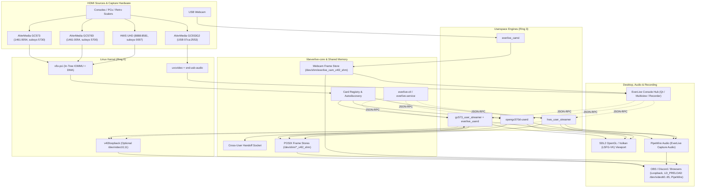

# Architecture & Design

EverLive runs its PCIe capture drivers in **Ring 3 (userspace)** via Linux's in-tree `vfio-pci` subsystem, avoiding out-of-tree kernel modules, DKMS rebuilds, and UEFI Secure Boot MOK enrollment.

## Key Components

- **`vfio-pci` (Kernel, Ring 0):** Isolates the capture card inside an IOMMU container and maps BAR0 MMIO + scatter-gather DMA buffers directly into userspace.
- **`libeverlive-core` (`tools/libeverlive-core/`):** Shared framework providing PCI card autodiscovery, `everlive_framestore` (lock-free triple-buffered POSIX shared memory `/dev/shm/*_v4l2_shm`), reusable `LD_PRELOAD` V4L2 camera shims, cross-user handoff (`\0everlive-handoff-<bdf>` via `SO_PEERCRED`), `everlive_osd`, `everlive-ctl`, and `everlive.service`.
- **Per-Card Userspace Engines (Ring 3):**
  - `tools/opengc573-userd/`: `gc573_user_streamer` (video/audio DMA, Hable HDR→SDR, AC-3/DTS decode, S3 suspend/resume, LSFG-VK path) + `everlive_userd` (FD-preserving standby daemon to avoid PCIe FLR).
  - `tools/opengc570d-userd/`: `opengc570d-userd` (dual HDMI DMA rings, BT.2020 LUT, stereo LPCM).
  - `tools/openhws-userd/`: `hws_user_streamer` (quarter-DMA 4K60, stereo LPCM).
- **Webcam Bridge (`tools/everlive-cam/`):** `everlive_camd` opens the physical webcam once and publishes frames to `/dev/shm/everlive_cam_v4l2_shm` for Console Hub PiP, `ffmpeg` recordings, and `/dev/video65` (`libeverlive-cam-v4l2.so`).
- **Console Hub (`tools/everlive/`):** Python/Qt frontend managing card selection, Multiview, recordings, background service, and JSON-RPC IPC (`everlive.sock`).

## Architecture Diagram

